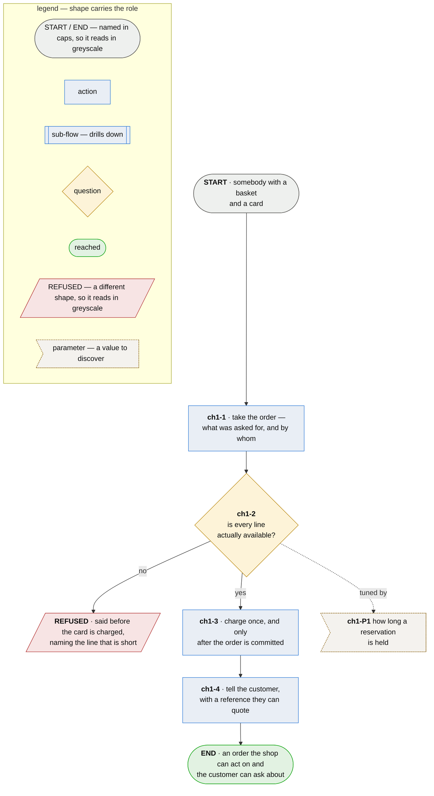

# Chapter 1 — a customer places an order and knows it was taken

**Last updated** 2026-09-15 v1

> **As a customer I want to place an order and be told it was accepted, so that I know I will be
> charged for something that is actually coming.**

An order that is silently dropped and an order that is quietly duplicated look identical to whoever
placed it: nothing arrives, or two things do, and in both cases the shop knew and the customer did
not. This flow is the moment between those two.

## Nodes

### ch1-1 · take the order

> **As a customer I want the shop to record what I actually chose, so that nothing is reconstructed
> from stock levels later and quietly changed.**

#### Information

| Information | IO | Description | Required | Provenance |
|---|---|---|---|---|
| ch1-1-inf1 | In | `basket` | yes | authored |
| ch1-1-inf2 | In | `customer` | yes | authored |
| ch1-1-inf3 | Out | `order` | yes | derived |
| ch1-1-inf4 | Out | `order.reference` | yes | generated |

#### User Requirements
  * ch1-1-ur1 - the order records what the customer chose, at the moment they chose it
  * ch1-1-ur2 - nothing about the order is reconstructed later from stock levels or prices

#### System Requirements
  * ch1-1-sr1 - the reference is unique across all orders and is generated, never typed

#### Non-Functional Requirements
  * ch1-1-nfr1 - a shop that rebuilds a basket at dispatch time is answering a different question
    from the one the customer asked

#### Unknowns

---

### ch1-2 · is every line actually available?

> **As a customer I want to be told a line is short before my card is touched, so that I am not
> refunding money I should never have paid.**

#### Information

| Information | IO | Description | Required | Provenance |
|---|---|---|---|---|
| ch1-2-inf1 | In | `order` | yes | ch1-1 |
| ch1-2-inf2 | Out | `reservation` | optional | derived |
| ch1-2-inf3 | Out | `refusal` | optional | derived |

#### User Requirements
  * ch1-2-ur1 - a short line is said before the card is touched, and the refusal names the line
  * ch1-2-ur2 - stock for an order that passes is held, so it cannot be sold twice

#### System Requirements
  * ch1-2-sr1 - the reservation exists only between this check and the charge, and is released
    whichever way the charge goes

#### Non-Functional Requirements
  * ch1-2-nfr1 - the cost of getting this backwards is not symmetric: refusing an order that could
    have been filled loses a sale, and charging for one that cannot be filled takes money for
    nothing and spends the refund, the apology and the trust to put it back

#### Unknowns
  * ch1-2-u1 - how long a reservation is held is not measured; too short and a slow card releases
    stock somebody has been promised, too long and a browsing customer holds stock nobody can sell

---

### ch1-3 · charge the card once

> **As a customer I want to be charged exactly once for one order, so that a retry somewhere in the
> shop's plumbing is not a second payment out of my account.**

#### Information

| Information | IO | Description | Required | Provenance |
|---|---|---|---|---|
| ch1-3-inf1 | In | `order` | yes | ch1-1 |
| ch1-3-inf2 | In | `order.reference` | yes | ch1-1 |
| ch1-3-inf3 | Out | `charge` | yes | observed |

#### User Requirements
  * ch1-3-ur1 - one order is charged exactly once, however many times the request is sent

#### System Requirements
  * ch1-3-sr1 - the charge is keyed by the order's reference, so a retry is recognised as the same
    charge rather than a second one

#### Non-Functional Requirements
  * ch1-3-nfr1 - the network between a shop and a processor drops responses as readily as
    requests, so *the charge succeeded* and *the charge is unknown* arrive as the same evidence —
    and a retry always happens eventually

#### Unknowns

**Decision `ch1-D1` — the processor's reconciliation window closes at 02:00.** External, known, and
restricting: a charge submitted near it may settle on either side of the boundary, so nothing here
may assume same-day settlement. It is not this shop's to negotiate.

---

### ch1-4 · tell the customer

> **As a customer I want a reference I can quote back, so that when I need to ask about my order
> there is something to ask about.**

#### Information

| Information | IO | Description | Required | Provenance |
|---|---|---|---|---|
| ch1-4-inf1 | In | `order.reference` | yes | ch1-1 |
| ch1-4-inf2 | In | `charge` | yes | ch1-3 |
| ch1-4-inf3 | Out | `confirmation` | yes | derived |

#### User Requirements
  * ch1-4-ur1 - the confirmation carries the reference, so the customer has something to quote

#### System Requirements

#### Non-Functional Requirements
  * ch1-4-nfr1 - a confirmation carrying no handle is a courtesy rather than a record: it cannot be
    searched for, cited in a complaint, or used by the shop to find the order it refers to

#### Unknowns
  * ch1-4-u1 - what happens to a basket abandoned mid-charge is undecided: the card was submitted,
    no response came back, the order is neither placed nor refused, and settling it needs the
    processor's reconciliation behaviour

## Glossary

| Term | Meaning |
|---|---|
| Basket | What a customer chose, before it is an order. It has no reference and the shop owes nothing on it |
| Order | A basket the shop has accepted responsibility for. It has a reference from the moment it exists |
| Short | A line the shop cannot fill in the quantity asked for. Not the same as *out of stock*, which is a property of the item rather than of this order |
| Provenance | Where an input came from, or how an output was made |
| Authored | Written by a person. An input nothing produces, or an output somebody typed |
| Derived | Computed by this step from what it took in |
| Observed | Read off a run, or the world as it stands |
| Generated | Made by a tool rather than by a person, and not recomputable |
