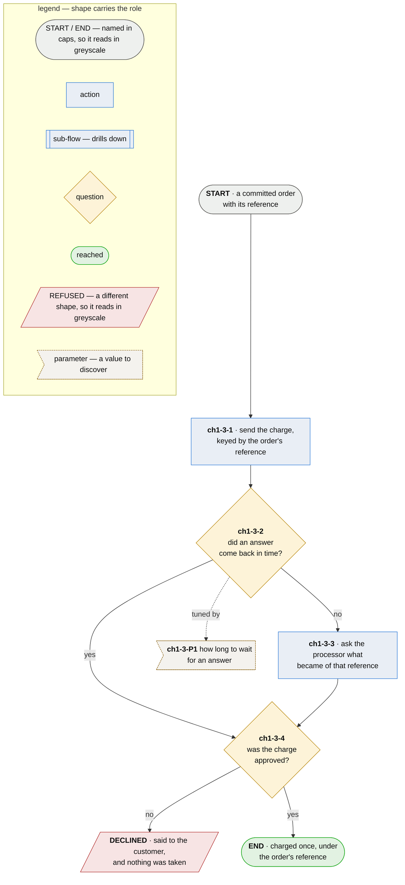

# Chapter 1.3 — the card is charged exactly once

**Last updated** 2026-10-26 v2

> **As a customer I want my card charged once for my order, however the processor's answers arrive,
> so that a slow network is never a second payment out of my account.**

The drill-down of step `ch1-3` in [chapter 1](chapter-01-ordering.md). A charge whose answer never
came back is the hard case: resending it risks charging twice, and dropping it risks an order that
was paid for and never placed.

## Nodes

### ch1-3-1 · send the charge

> **As a customer I want the charge sent under my order's reference, so that whatever happens to it
> afterwards can be traced back to the one order it belongs to.**

#### Information

| Information | IO | Description | Required | Provenance |
|---|---|---|---|---|
| ch1-3-1-inf1 | In | `order` | yes | parent |
| ch1-3-1-inf2 | In | `order.reference` | yes | parent |
| ch1-3-1-inf3 | Out | `charge request` | yes | derived |

#### User Requirements
  * ch1-3-1-ur1 - the amount charged is the order's total, as the customer accepted it

#### System Requirements
  * ch1-3-1-sr1 - the request carries the order's reference as its key, so the processor treats a
    repeat as the same charge

#### Non-Functional Requirements

#### Unknowns

---

### ch1-3-2 · did an answer come back in time?

> **As a customer I want the shop to notice when my charge has gone unanswered, so that silence is
> never read as either a payment or a refusal.**

#### Information

| Information | IO | Description | Required | Provenance |
|---|---|---|---|---|
| ch1-3-2-inf1 | In | `charge request` | yes | ch1-3-1 |
| ch1-3-2-inf2 | Out | `processor answer` | optional | observed |

#### User Requirements
  * ch1-3-2-ur1 - no answer is treated as *unknown*, never as approved or declined

#### System Requirements

#### Non-Functional Requirements
  * ch1-3-2-nfr1 - a lost response and a lost request look the same from here, so the only safe
    next step is to ask rather than to send again

#### Unknowns

**Parameter `ch1-3-P1` — how long to wait for an answer.** The model is available today: the
distribution of the processor's response times bounds it from below, because waiting less than a
slow answer takes asks about charges that are still on their way; the time a customer will watch a
spinner bounds it from above. Working value ten seconds; confirmed by those two bounds.

---

### ch1-3-3 · ask the processor what became of the charge

> **As a customer I want the shop to find out what happened to my charge before doing anything
> else, so that I am not charged a second time for an answer that was merely late.**

#### Information

| Information | IO | Description | Required | Provenance |
|---|---|---|---|---|
| ch1-3-3-inf1 | In | `order.reference` | yes | parent |
| ch1-3-3-inf2 | Out | `processor answer` | yes | observed |

#### User Requirements

#### System Requirements
  * ch1-3-3-sr1 - the lookup is by the order's reference, and it never submits a charge

#### Non-Functional Requirements

#### Unknowns
  * ch1-3-3-u1 - what to do when the processor has no record of the reference either is
    undecided: send once more under the same key, or refuse the order and say so

---

### ch1-3-4 · was the charge approved?

> **As a customer I want to be told plainly when my card is declined, so that I know nothing was
> taken and can pay another way.**

#### Information

| Information | IO | Description | Required | Provenance |
|---|---|---|---|---|
| ch1-3-4-inf1 | In | `processor answer` | yes | ch1-3-2 |
| ch1-3-4-inf2 | Out | `charge` | optional | derived |
| ch1-3-4-inf3 | Out | `decline` | optional | derived |

#### User Requirements
  * ch1-3-4-ur1 - a decline is said to the customer, with the processor's reason where it gave one

#### System Requirements

#### Non-Functional Requirements

#### Unknowns

## Glossary

| Term | Meaning |
|---|---|
| Charge request | What the shop sends the processor. It is not a charge until the processor approves it |
| Processor answer | What the processor says about one reference: approved, declined, or no record of it |
| Decline | The processor's refusal of a charge. Nothing was taken, and the order goes no further |
