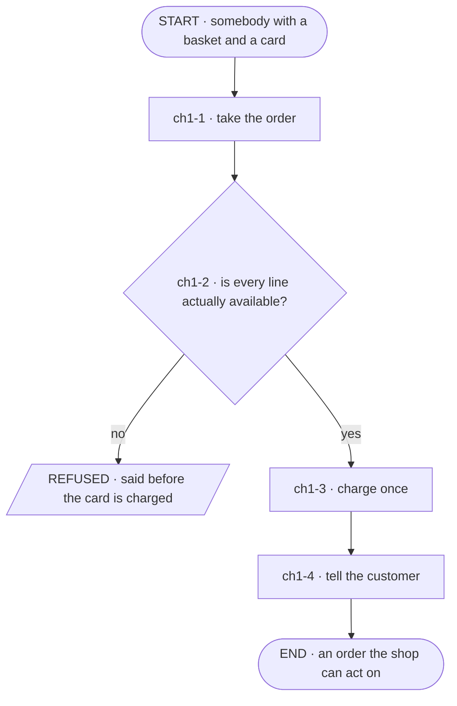
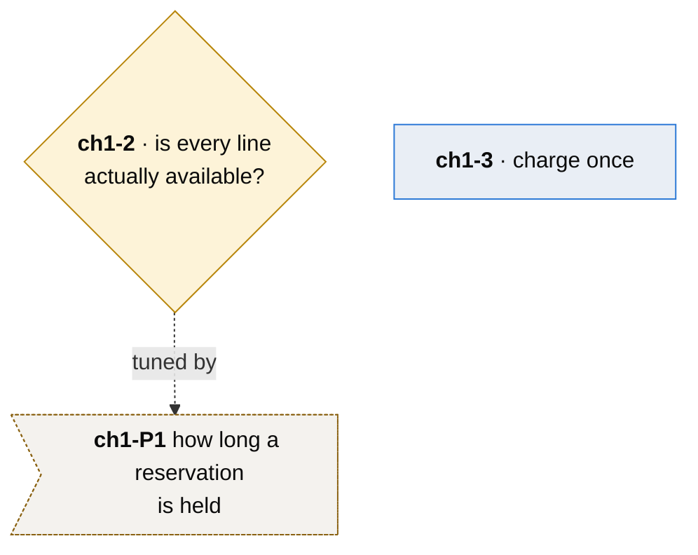
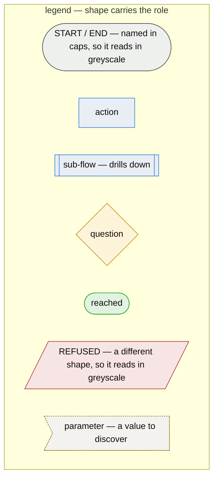
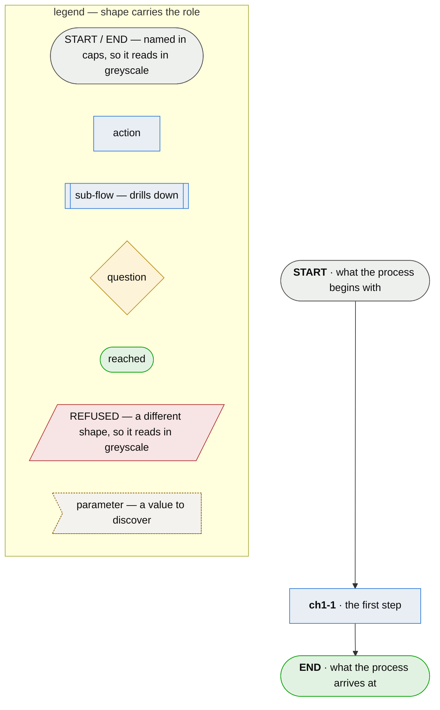

# Getting started

**Write your first chapter, understand every part of it, and get the gate green.**

This walks one complete chapter part by part, inside the shape every corpus takes: **one main flow,
and a drill-down for each step that is itself a process.**

    chapter-01-ordering.md            the main flow: ch1-1 take the order … ch1-4 tell the customer
    └── chapter-01.3-charging.md      step ch1-3, charging, is a process of its own: ch1-3-1 …

Both ship in [`docs/example/`](example/), with
[`chapter-01-ordering.md`](example/spec/diagrams/chapter-01-ordering.md) named as the main flow,
and goldspec's own test suite runs the gate over them on every run, so what you read here is what
the gate accepts. A second chapter is a drill-down of a step, or a process this one links to (§2);
never a second top-level flow beside the first.

**Reading order.** A first chapter needs §1–§5, then [§8's template](#a-whole-chapter-to-copy) to
start from and [§9](#9-run-the-gate) to read what the gate says. Converting a document you already
have? Read [§13](#13-bringing-in-a-document-you-already-have) too. The rest can wait until you
meet it.

You need `goldspec` installed — it runs on Python 3.9 or later — and a directory. Nothing else: no
project, no test suite, and your own work need not be in Python.

    mkdir -p spec/diagrams

A spec is markdown a person reads. There is no vocabulary to import and no module a runner has to
collect.

---

## 1. A chapter is a process flow

Not a subsystem, not a component, not a team's area. **A chapter is one process, from start to
done**, and it contains **many user stories** — one for every step in it.

That is the single most important sentence on this page, and getting it wrong produces a chapter
called *the payments service*, which accepts any sentence about payments and grows until nobody
reads it. A process has a start, an end, and steps in between; most sentences are not one of its
steps, so most sentences are refused on sight.

The chapter opens with the process's own story:

> **As a customer I want to place an order and be told it was accepted, so that I know I will be
> charged for something that is actually coming.**

### Every step is a user story too

A node in the flow is **something a person does for a reason** — so it takes the same shape:

> **As a customer I want to be told a line is short before my card is touched, so that I am not
> refunding money I should never have paid.**

| Part | What it is for | What goes wrong without it |
|---|---|---|
| **As a** \<role\> | who this step is for | a step with no role is a task, and tasks have no acceptance |
| **I want** \<something\> | what they are trying to do, in their words | written in the system's words it becomes a design note and stops being arguable |
| **so that** \<goal\> | why the step is worth performing | nothing can say the step is *finished* — only that code for it exists |

**The role can be a machine, and usually should not be.** *As a firewall I want to drop the packet*
is legal. It is also a sign you have stopped asking who is being helped — this is technology built
for people, not for its own sake, and a flow whose every actor is a component has quietly become an
architecture diagram. Ask who is worse off if the step never happens. If the answer is a component,
look one level out for the person behind it.

### The three things that are not the story

All three read as diligence, and all three are the usual first-chapter failure:

1. **The solution.** *As a customer I want my basket held in Redis with a 30-minute TTL.* That is an
   implementation choice. The story is what the customer wants; how you do it is the design, and the
   design belongs where it can be argued with and replaced without touching the story.
2. **The incident.** *On 12 March a duplicate charge occurred because the retry handler…* is
   history. Put it in the commit message, which is version-anchored and stays true after the state
   it describes has moved on. A story that narrates an incident has to be rewritten every time the
   incident recedes, and nobody rewrites it, so it reads as current forever.
3. **The status.** *…(done, verified in staging)* is an authored verdict. A chapter never carries
   status. What is proven is derived from a run, and a `Status:` line is true because somebody typed
   it — which is the failure this whole method exists to remove.

The test is mechanical: **if deleting the sentence would change what the system must do, it belongs
in the chapter. If it would only change what somebody knows about the past, it belongs in a commit
message.**

---

## 2. The hierarchy, and why you cannot get the altitude wrong

**A flow can turn out to be a step inside a larger flow, and that costs you nothing.** It is the
normal case. Interview a business and they will tell you where they think their process starts;
half-way through you discover it begins two departments earlier. The flow you drew does not get
thrown away — it acquires a parent, and becomes one node in it.

So a step that is itself a process gets its own file, and the file name carries the drill-down:

| File | ids inside it |
|---|---|
| `chapter-01-ordering.md` | `ch1-1`, `ch1-2`, … |
| `chapter-01.3-charging.md` | `ch1-3-1`, `ch1-3-2`, … |
| `chapter-01.3.2-retries.md` | `ch1-3-2-1`, `ch1-3-2-2`, … |

`chapter-01.3-charging.md` is the drill-down of node `ch1-3`. Every id inside it is prefixed
`ch1-3`, and in the parent that node is drawn as a **sub-flow** — `[[…]]` `:::subroutine` — so a
reader knows to follow it. **A drill-down of a drill-down keeps every number**, separated by dots:
`chapter-01.3.2-….md` expands step `ch1-3-2`, and its ids are prefixed `ch1-3-2`.

The worked example carries one: step `ch1-3` of
[`chapter-01-ordering.md`](example/spec/diagrams/chapter-01-ordering.md) drills into
[`chapter-01.3-charging.md`](example/spec/diagrams/chapter-01.3-charging.md). Its other steps are
plain actions, because they did not need one.

**A sub-chapter carries all the same sections.** It is a flow like any other; nothing about it is
abbreviated.

### When to split, and when to fold

One rule, and it is a legibility rule: **a flow should print legibly on one sheet of paper.**

- **Too dense to read?** A step is hiding a process. Give it its own file.
- **Too sparse to be worth its own page?** Fold it into its parent.

It applies to the **expansion** as well as the drawing, and that half catches more. A node whose
story and reasoning run past a page is a node hiding a flow — its steps had nowhere to be, so they
became sentences. If one of your nodes is turning into an essay, you have found a sub-process, not a
badly-written story.

### How big is too big, in numbers

**This is a working heuristic, not a rule the gate holds you to:**

| Nodes | What it usually means |
|---|---|
| 1–3 | too thin to be its own flow — fold it into its parent |
| **4–9** | the ordinary case |
| 10–14 | look hard for one step that is really a process |
| 15+ | there is a sub-flow in there, and probably two |

Applied to the **drawing**. The expansion of a ten-node chapter runs to several pages and that is
normal — what the rule asks of the expansion is that no *single node* needs more than about a page,
not that the chapter fits on one.

Treat all of it as a prompt to look rather than a threshold to obey. A ten-step process that genuinely
has ten steps is a ten-node chapter, and splitting it to hit a number would be the tool choosing the
shape of somebody's business.

### Where the hierarchy stops

**Downward**, it stops when the business stops saying *"oh, I forgot to tell you about…"*

**Upward**, it stops somewhere different in kind: when the steps stop being things a person does and
become **quantities to tune** toward a goal. A flow made mostly of parameters rather than stories is
at the ceiling. That is a thing you notice rather than decide.

### One main flow

**A corpus has one flow it starts from, and every other flow is reached from it** — drawn as one of
its steps, or as a step of a flow under it, or linked from one that is. A reader starting at the
top can then find every chapter, and a flow nobody reaches is one nobody will read.

**Every other flow is a drill-down of the step it is entered from, and is named for that step.**
A flow entered at `ch1-3` is `chapter-01.3-….md` (or `ch1-3-….md` in a corpus whose files are named
by sigil), and its steps are `ch1-3-1`, `ch1-3-2`. The file names alone then show the tree, and
nobody has to open a file to find out where it sits. A second root, named for nothing in the tree,
is the sprawl this rule is there to prevent.

**Drawn or linked — one question decides it: is the other process part of this one?**

- **Part of this process** — a step that is itself a process. Draw it as a sub-flow, `[[…]]`, and
  give it a chapter named for that step.
- **Another business process the work leaves for** — billing, after a clinic has treated somebody;
  the warehouse, after the shop has taken an order. Do not draw it. **Link it**: put a markdown link
  to its file, `[billing](chapter-01.5.3-billing.md)`, in the prose of a chapter that is reached —
  the chapter's introduction or a node's text both count. Name the linked chapter for the step that
  hands off, exactly as for a drill-down: a hand-off at `ch1-5-3` is `chapter-01.5.3-billing.md`,
  with steps `ch1-5-3-1`, … — so the names still show the tree. Any of its steps may take what is
  handed over with provenance `parent` (§4).

  **Naming the linked chapter for a step does not make that step a sub-flow.** Only `[[…]]` does.
  The step that hands off stays an ordinary action or question, and the gate asks nothing more of
  it. Where the hand-off ends this process, that ending is reached: draw it `([…])` `:::good` and
  name the hand-off in its label — `END · handed to billing`. Where this process carries on, draw
  the flow on past the step that links.

  **The linked chapter must exist when the link does.** A link to a file named like a flow that is
  not in the flow directory is a fault — `chapter-01-ordering.md links chapter-01.5.3-billing.md,
  which is not a flow in spec/diagrams/` — so write the hand-off chapter first, or add the link in
  the same edit that creates it.

  **Where the other process already has a spec of its own** — another team's, in its own namespace
  — link into theirs rather than writing a second one, with a relative path:
  `[billing](../../billing/spec/diagrams/chapter-01-billing.md)`. Declare that spec under
  `siblings` (§11), and the run reads what its chapters take, so what you hand over stops being
  listed as an observation (§9); it never checks them. A link carrying a path is **not followed**:
  it neither reaches a flow nor is checked for existence, so a wrong path is caught by nobody. A
  sibling is read under its own `goldspec.toml`, however it names its files — each project keeps
  its own conventions file. Keep the hand-off chapter in this corpus instead when nobody else has specified
  that process, or when this team owns it — then it is named for the step, reached, and gated like
  every other chapter.

One consequence catches people. **Something a sub-flow produces that a linked chapter consumes has
left the sub-flow**, so the parent's node for that sub-flow must list it as an `Out`. Leave it off
and the gate says so:

    chapter-01-ordering.md#ch1-5 does not declare charge request, which the chapter it drills into
      produces and another chapter consumes

goldspec's own spec is laid out this way: `spe-specify-a-process.md` is the main flow;
`spe1-1-enter-the-method.md`, `spe6-1-…`, `spe6-2-…` and `spe6-3-…` expand its steps; and
`spe6-2-3-1-share-a-word-across-owners.md` expands a step of `spe6-2`.

Name the main flow in your conventions with `main_flow`, and the gate holds the rest: **a flow
neither drawn from it nor linked from a flow that is reached is a fault.** Left unnamed, nothing can
be held to it, so the run warns instead when more than one flow is entered from nothing — no other
flow drills into it or links to it — and suggests the one that reaches the most:

    goldspec: warning: 2 flows are entered from nothing — chapter-01-ordering.md, chapter-02-returns.md — and no main_flow is named, …

 *Drawn* means a step drawn
as a sub-flow, `[[…]]`, whose chapter's steps are numbered under it. *Linked* means a markdown link to
the flow's file by its bare name — a file in the same directory — `[…](chapter-01.3-charging.md)`,
anywhere in a reached flow. A flow
entered from several places — the same hand-over used by more than one step — is linked from where
it is entered rather than drawn twice. A flow that is only ever linked, and drawn nowhere, is
legitimate, but it usually marks work being handed off to another business process.

---

## 3. Draw the flow first

Write the diagram before any prose. It is the cheapest part to change and it finds the most, because
a flow will not let you leave a step out — a box has to connect to something.



**What the gate checks:**

- **Steps and decisions carry ids; terminals and legend nodes do not.** An id in the diagram must
  have a `###` block, and a block must have an id in the diagram — the gate reports either alone.
  `START`, `END`, a refusal, and every node inside the legend are unidentified, which is what keeps
  them out of that check.
- **The flow has a start and an end.** If every node is pointed at by another, nothing says where it
  begins. Two ends are fine, and so is a cycle.
- **Every class a node names is defined by a `classDef`** in the same mermaid block. Use one that is not
  and the node renders unstyled, so the gate names it rather than letting the mistake be invisible.

**What is advice, and worth taking:**

- **Shape carries the role** — rectangle acts, diamond asks, stadium terminates.
- **A refusal is a real ending.** *The order is short, so nothing is charged* is an outcome the
  system produces on purpose. Flows that draw only the happy path ship with unhandled failures.
- **Colour is never the only encoding** (see below).

**The drawing is what finds the defects.** A defect can sit undisturbed for as long as it is prose
and become obvious the moment it has to be a box with edges — an activity happening twice under two
names, for instance, which is how a step gets done twice or not at all.

### The shapes, and how to draw the ones that are not boxes

Mermaid `flowchart`, and seven roles. Copy this block into your first chapter and you have the whole
dialect:

| Role | Mermaid | What it is |
|---|---|---|
| start / end | `([…])` `:::terminal` | where the flow begins, and where it finishes |
| action | `[…]` `:::process` | a step somebody performs |
| question | `{…}` `:::question` | a question with named arms |
| sub-flow | `[[…]]` `:::subroutine` | a step that drills down into its own chapter |
| reached | `([…])` `:::good` | a successful ending |
| refused | `[/…/]` `:::bad` | an ending that is a refusal, and is on purpose |
| parameter | `>"…"]` `:::parameter` | a value still to discover, hanging off the step it tunes |

**The diamond is a *question*, not a decision.** A question is a fork in the flow with named arms;
a *Decision* (`ch1-D1`, §5) is a choice already settled, stated under a step, and is never drawn.

**Parallel work has no shape of its own.** Draw two unlabelled edges out of the step that starts
both pieces of work, and join them at the step that needs both:

    PACK[ch1-5 · pack the parcel]:::process
    PACK --> LABEL[ch1-6 · print the label]:::process
    PACK --> INVOICE[ch1-7 · write the invoice]:::process
    LABEL --> SEND[ch1-8 · hand it to the courier]:::process
    INVOICE --> SEND

Not a question with two `yes` arms: a question's arms are alternatives, and only one of them runs.
The fork may be `START` itself, when the work opens with two things at once.

**The join takes each branch's output as a row of its own.** `ch1-8` needs both, so its Information
table carries one `In` per branch, each naming the step that made it and each `Required: yes`:

    | ch1-8-inf1 | In | `label` | yes | ch1-6 |
    | ch1-8-inf2 | In | `invoice` | yes | ch1-7 |

Seven shapes, and the set is closed. Six of them are steps of the flow. The seventh hangs off one:

**A parameter may be drawn, and an unknown or a decision never is.** A parameter is a quantity the
step needs a number for, so showing it beside that step is how a reader sees what is still being
tuned. What is undecided and what is imposed carry ids under the node they affect (§5) instead —
drawing them turns a flow into a noticeboard.



**Quote a parameter's label — `P1>"…"]`, with the quotes.** This is the one shape where that is
not optional. A parameter is not a step, so it gets no `###` block; unquoted, its id reads as a
node the diagram draws, and the gate then asks for the block that is never coming. The quotes are
what keep it out of that check, exactly as a legend node's lack of an id keeps the legend out. The
legend's sample parameter carries no id, so it would pass unquoted; it is quoted anyway, so the
legend you copy shows the form you write.

**A parameter is not an ending.** It hangs off its step by a dotted edge and nothing leaves it,
which would make any other node an end; the start-and-end check skips anything drawn in the
parameter shape `>"…"]`, whatever class it carries.

**Everything else that is undecided or imposed stays out of the picture**, under the node it
affects (§5), where a reader meets it beside the step rather than in the margin of a drawing.

**Colour is never the only encoding**, and this dialect needs the help: *start / end* and *reached*
are both `([…])`, so in greyscale they are the same box. The text is what separates them — shout
`START`, `END` and `REFUSED` in the label, as the example does. A reviewer may be colour-blind and a
printed page is always grey.

**Quote any label that contains a `"`, `(`, `[` or `{`.** One of those inside an unquoted label
makes Mermaid read the start of another shape, the parse dies, and it takes the **whole diagram**
with it — nothing renders, and every gate that reads the markdown around the fence still passes.
The rule is about what is *inside* a label: `LD{question}` is fine because the braces are the
shape's own, and `subgraph LEGEND["…"]` is fine because it is already quoted. A label reading
`ch1-2 · check the price (before tax)` is not.

**Ship a legend, and the `classDef` lines under it.** Both go inside the same mermaid fence as your
flow. The legend is a `subgraph` holding one sample node per role; its nodes carry short names of
their own — `LT`, `LA`, `LD` — and **no ids**, which keeps them out of the node-block check, and they
connect to nothing, which the start-and-end check does not mind. The `classDef` lines are identical
in every chapter, and a class you use without defining is a fault the gate will name.

This is the whole block, drawn and then given as source. Paste it into your chapter and you have the
dialect:



**Draw a sub-flow only once the chapter it drills into exists.** `[[…]]` `:::subroutine` is a
promise the gate collects: a node drawn as a sub-flow with no chapter expanding it is reported as
`is drawn as a sub-flow and no chapter expands it`. While `ch1-3` is still one step, draw it as an
ordinary action; redraw it as a sub-flow in the same edit that creates
`chapter-01.3-charging.md`.

In the parent, a sub-flow node keeps an ordinary `###` block with its Information table stated at
the parent's altitude — what the whole sub-process takes and leaves, not what its steps do. The two
sides are held against each other: the parent may not claim to leave with what no step of the child
produces, may not take what no step of the child consumes, and must take what the child needs and
neither makes for itself nor gets from outside any step. And what the child produces that another
chapter consumes must be declared on the parent's node, because that is the step it leaves
through. What the child makes and takes below itself — in its own steps, or in a chapter it drills
into at whatever depth — never left it, and the parent does not restate it. All of this is matched
on the Description cell, by the rule in §4, so the two files have to spell a thing the same way.

**Everything in the child is prefixed by the parent's node id**, and nothing about the child is
abbreviated — same sections, same legend, same stamp. The worked example's
[`chapter-01.3-charging.md`](example/spec/diagrams/chapter-01.3-charging.md) is one, and this is
how its names line up with the parent's:

| in the parent | in the child `chapter-01.3-charging.md` |
|---|---|
| node `ch1-3`, drawn `[[…]]` `:::subroutine` | its steps are `ch1-3-1`, `ch1-3-2`, … |
| — | an Information row is `ch1-3-1-inf1` — node id, then kind, then number |
| — | a requirement is `ch1-3-1-ur1`, an unknown `ch1-3-1-u1` |
| — | a parameter is `ch1-3-P1` and a decision `ch1-3-D1` — one series per chapter, as anywhere |
| its `###` block says what the whole sub-process takes and leaves | a row taking what the parent hands in says `parent` in Provenance |

**`parent` goes on whichever step first takes a thing handed in from above** — not only on the
child's first step. In the example, `ch1-3-1` takes `order` and `order.reference` from `parent`, and
`ch1-3-3`, two steps later, takes `order.reference` from `parent` too, because nothing in the child
made it. Such a row's `Required` says what *that step* needs, like any other row; the parent's own
row does not decide it.

The child's H1 names the process from a person's side like any other chapter, and carries the
drill-down number: `# Chapter 1.3 — the card is charged exactly once`. Nothing checks that wording,
and a title that disagrees with the parent's node text is a thing only a reader catches.

**Node labels may carry markup, and usually should.** The snippets on this page are written plainly
so the shape is visible, but real labels get long: `<b>ch1-1</b>` sets the id off from the text and
`<br/>` wraps a label that would otherwise stretch the diagram into one very wide row. The
[worked example](example/spec/diagrams/chapter-01-ordering.md) does both. Nothing is checked here —
it is the legibility rule again, applied to the drawing.

---

## 4. `## Nodes` — the story, and the information it moves

One `###` block per node. The node carries its story, then a table of what it takes and leaves:

    ### ch1-2 · is every line actually available?

    > **As a customer I want to be told a line is short before my card is touched, so that I am not
    > refunding money I should never have paid.**

    #### Information

    | Information | IO | Description | Required | Provenance |
    |---|---|---|---|---|
    | ch1-2-inf1 | In | `order` | yes | ch1-1 |
    | ch1-2-inf2 | Out | `reservation` | optional | derived |
    | ch1-2-inf3 | Out | `refusal` | optional | derived |

**The information lives with the step that moves it, and nowhere else.** A reader holding one node
should not have to hold a diagram, a chapter-level table and a glossary in their head to answer
*where does this arrive from*. So the answer sits in the row that raises the question.

**Every row carries an id**, because a constraint on one piece of information is a thing a room has
to be able to point at by name.

**`IO`** is `In` or `Out`. In is what the step needs to begin; Out is what it leaves behind.

**`Description`** names the information. Backtick an element name where the corpus has one —
`order.reference` means one thing everywhere — and write plain words where it does not: *the team's
own backlog* is a real input that no step produces and no corpus defines.

**This cell is what makes two rows the same thing, and it is matched exactly.** A row carrying
backticks names what is inside them; a row with none names its whole description. So `` `order` ``
in one step and `` `order` `` in another are one piece of information, and `` `order` `` against
*the customer's order* are two — the chain will report the second as arriving from nowhere, and a
sub-flow's two halves as disagreeing about what crosses between them. A dotted name is the one
exception: a step producing `` `order` `` satisfies a step taking `` `order.reference` ``, because
the part comes with the whole.

Pick a spelling for each thing once and use it everywhere, including across chapters. That is the
whole of the convention, and it is the fact every derived check rests on.

**`Required`** says whether the person must have it, which is a different question from where it
comes from. **An arm of a question is `optional` on the way out and may be `yes` on the way in**:
`ch1-2` leaves with a `reservation` *or* a `refusal`, so each is `optional` there, and the step down
the yes-arm takes the reservation as `yes` because that arm does not run without one. The two
columns are answering about different things — one about the step that made it, one about the step
that needs it.

Two values: **`yes`** and **`optional`**. `yes` is the only one that means *this step does not run
without it*, and it is the only one the chain and the provenance checks hold you to — anything else
is read as *can proceed without*, so a row a step genuinely needs must say `yes` exactly. A backlog is required and has no producer; a board has a producer and is not required,
because on a first run no run has written one.

**`Provenance`** is the column the rest of the table exists to carry, and it is a closed set:

| it says | it means | legal on |
|---|---|---|
| a step's id, like `ch1-1` | that step, in this flow, produced it | `In` |
| `parent` | handed in from above — by the chapter drilling into this one, or handing off to it by link — on whichever step first takes it | `In` |
| `authored` | somebody wrote it down; nothing produces it | both |
| `observed` | read off a run, or the world as it stands | both |
| `generated` | made by a tool, and not recomputable | both |
| `derived` | computed by this step from what it took in | `Out` |

Read the column as the answer to *if this were lost, could it be got back* — ask its author, run it
again, recompute it, or it is gone.

**The last column is checked against the flow, not just against the list.** Name a step and that
step must actually have an `Out` row for the same thing; where the row is `Required: yes`, the
drawing must reach this node from that one. A row saying `ch1-1` for something `ch1-1` never
produces is the habit the column exists to catch, and it survives every other gate.

**Types, lengths, keys and nullability are not here.** A spec is read by the people who own the
work, and a chapter that mixes their language with storage detail stops being theirs. Those belong
in a document behind the node, for whoever is building against it.

## 5. The requirements, and what is undecided

Under the Information table, four headings, always in this order and always present even when empty:

    #### User Requirements
      * ch1-2-ur1 - a short line is said before the card is touched, and the refusal names the line

    #### System Requirements
      * ch1-2-sr1 - the reservation is released whichever way the charge goes

    #### Non-Functional Requirements
      * ch1-2-nfr1 - refusing an order that could have been filled loses a sale; charging for one
        that cannot takes money for nothing

    #### Unknowns
      * ch1-2-u1 - how long a reservation is held is not measured

**A bullet is `  * <id> - <what it requires>`**, with a hyphen between the id and the text (an en
or em dash reads the same). Not a colon, and not nothing: the separator is what the parser reads,
and the gate names a bullet written another way rather than passing over it. **The marker is `*`
and only `*`.** A requirement under `-`, `+` or a number (`1.`) is reported as *written in a shape
nothing reads*, exactly like `* ch1-2-ur1: …` — the shape a converted document most often arrives
in.

**A constraint is a requirement with an id, on the step it constrains.** There is no chapter-level
list of them — that would move a constraint away from the thing it constrains.

**Split by kind**, because the three are argued with by different readers: what the person needs,
what the system must do, and what holds whatever the design.

**If the story is complete and the requirements are complete, there is no prose left to write.** A
paragraph inside a node is a requirement that has not been given an id yet.

### Everything a node block holds, in order

    ### ch1-2 · <the step, named as the flow names it>

    > **As a <role> I want <something> so that <goal>.**       <- the story

    #### Information                                           <- the five-column table

    | Information | IO | Description | Required | Provenance |
    |---|---|---|---|---|
    | ch1-2-inf1 | In | `order` | yes | ch1-1 |

    #### User Requirements                                     <- the three kinds of
    #### System Requirements                                      requirement, always
    #### Non-Functional Requirements                              in this order
    #### Unknowns                                              <- last

    **Parameter `ch1-P1` — …**   <- parameters and decisions, last of all
    **Decision `ch1-D1` — …**

**The five `####` headings are one set in one order.** State any of them and you owe all five, in
exactly this sequence; the gate names a node that drops one, adds one, or runs two together. An
empty heading is how a node says *none of these yet*, and it is simply the heading with nothing
under it:

    #### Non-Functional Requirements
      * ch1-4-nfr1 - a confirmation carrying no handle is a courtesy rather than a record

    #### Unknowns

    ---

That is the normal state of a chapter somebody is still writing, and the [worked
example](example/spec/diagrams/chapter-01-ordering.md) carries three of them.

**Parameters and decisions live at the foot of the node they constrain.** There is no
`## Parameters` section and no `## Decisions` section — adding one fails the section-set check, and
the fault names the wrong set without telling you where the content should have gone. A parameter
or a decision belongs to the step it constrains, so it sits with that step.

There is one other place, and only one, for the case where a constraint is genuinely not any single
step's:

**A constraint on the whole flow goes between the diagram and `## Nodes`**, in the same bold form:

    ```mermaid … ```

    **Decision `ch1-D1` — the processor's reconciliation window closes at 02:00.** …

    ## Nodes

Some constraints genuinely are not one step's — a regulatory clock that binds the whole process is
not the property of whichever node happens to start it, and hanging it on one node to satisfy the
format is bending the model to fit the tool. Flow-level and node-level decisions share one number series
per chapter.

### The four kinds of subject

**A subject is anything that carries an id**, and there are four kinds. Three of them hang off the
node they affect. The discriminators are worth learning once:

| Kind | Id | Known? | Has a model? | Waiting on |
|---|---|---|---|---|
| **Story** | `ch1-2` | the want is known | — | proof it is done |
| **Open unknown** | `ch1-2-u1` | the question is; the answer is not | no | a **decision** |
| **Parameter** | `ch1-P1` | it exists; the value does not | **yes** | a **discovery** |
| **Decision** | `ch1-D1` | already made; its influences may be external | no | its consequence observed |

**An unknown is numbered under its node and the other two under the chapter**, and the shapes are
what make that read: an unknown is a bullet in a list belonging to one step, so it is `ch1-2-u1`.
A parameter and a decision are run-in paragraphs that may hang off a node or off the whole flow,
so they share one series per chapter — `ch1-P1`, `ch1-D1` — and a chapter's third decision is
`ch1-D3` wherever in the file it is written. *The chapter* means the file's whole prefix: in the
drill-down `chapter-01.3-charging.md` a parameter is `ch1-3-P1` and a decision `ch1-3-D1`, as in
§3's table — never a continuation of `ch1`'s series.

**Unknown or parameter?** Both are not-knowing. An unknown is settled by *deciding*; a parameter is
settled by *measuring*, and what makes it a parameter is that you can write the **model** today — a
statement of what would confirm the value. *How long is a reservation held* has a model (the
distribution of reservation-to-charge times bounds it from below; stock held-and-abandoned bounds it
from above), so it is `ch1-P1`. *What should happen to a basket abandoned mid-charge* has no model,
only a choice, so it is `ch1-2-u1`, under the node it affects.

**A parameter may state its working value**, the number the process runs on until the model says
otherwise, with the model that would confirm it: *Working value fifteen minutes; confirmed by the
two distributions above.* Both parameters in the worked example carry one.

A parameter that nothing has measured shows on the board as **`unvalidated`** — the honest word for a
constant nobody has tested. **That word is derived and you never type it into a chapter.** Write the
model; whether it has been run is a fact about runs, and a parameter carrying its own status in the
prose would be the authored verdict this method exists to remove, wearing a different word.

**What is a decision?** A **choice already made**, often because of an external imposition that restricts how the process can work, rather than
something it enables, which the flow has to account for:

    **Decision `ch1-D1` — the processor's reconciliation window closes at 02:00.** External, known, and
    restricting: a charge submitted near it may settle on either side of the boundary, so nothing
    here may assume same-day settlement. It is not this shop's to negotiate.

A plain bold run-in paragraph, never a blockquote — the blockquote is reserved for a story, which is
how a reader tells the two apart at a glance. Parameters take the same form.

**The id sits inside the first bold run of the line**, before any other emphasis. That is what
separates *declaring* a decision from *mentioning* one: a node whose argument cites `ch3-U1`, an
unknown another chapter owns, is pointing at somebody else's subject and is not claiming to own it.
Citing across chapters is ordinary and nothing is checked about it.

It gets an id even though nothing is undecided about it, and the reason is different from every
other id here: **so that a room full of people can point at the same thing.** A second reason shows
up as soon as you write two — constraints in tension become visible. In prose, two constraints fifty
words apart read as one continuous line of reasoning.

---

## 6. Unknowns, and why there is no backlog

An unknown is a bullet under the node it affects, in that node's `#### Unknowns`:

      * ch1-2-u1 - how long a reservation is held is not measured; too short and a slow card
        releases stock somebody has been promised, too long and a browsing customer holds stock
        nobody can sell

**This is what replaces a backlog.** An unknown is a question anchored to a step; an **unproven
subject is the work item**. Anything anchored to nothing is not undefined — it is *uncommitted*, and
it should be dropped rather than filed. A side list of open questions is how a backlog regrows under
a new name, and it goes stale exactly the same way.

Write what would settle it. *We should look into caching* is not an unknown. *Whether the
processor's reconciliation window closes before ours does — needs their documentation read* is one,
because a reader knows what to go and do.

**A boundary is not an unknown.** Something the work deliberately does not do is a requirement. An
unknown says nobody has decided; unknowns that are really boundaries accumulate as false debt.

---

## 7. `## Glossary` — the words this flow uses differently

Last section, and it is not a dictionary of every noun. It is for words that mean something
**specific to this process**, and likely mean something else in a neighbouring one or in ordinary
English:

    | Term | Meaning |
    |---|---|
    | Order | A basket the shop has accepted responsibility for. It has a reference from the moment it exists |
    | Short | A line the shop cannot fill in the quantity asked for. Not the same as *out of stock*, which is a property of the item rather than of this order |

*Order* earns a row because the moment a basket becomes one is exactly what this chapter is about.
*Short* earns one because a neighbouring flow uses it to mean something else.

---

## 8. The whole file, in order

Two `##` sections, and the gate enforces both the set and the order:

    # Chapter 1 — <the process, named from a person's side>      <- H1 title
    **Last updated** 2026-09-15 v1                               <- the stamp
    > **As a <role> I want <something> so that <goal>.**          <- the flow's story
    <a paragraph or two of context, optional>
    ```mermaid … ```                                             <- the flow
    **Decision `ch1-D1` — …**                                    <- flow-level only, optional
    ## Nodes
    ## Glossary

The title, stamp, story and diagram come first, in that order, above the sections. A reader looking
for the glossary should never have to hunt for it.

### A whole chapter, to copy

Every part above in one file, with one node. Save it as `spec/diagrams/chapter-01-<process>.md`
and it passes the gate as it stands — the one thing the run says about it is an observation that
nothing takes `what it leaves`. Then replace every placeholder: the stamp's date, the
angle-bracketed text (the diagram's `<b>` is markup and stays), the diagram's labels, the step's
`###` heading, and the two Information rows. Add a node by copying the `###` block, renumbering every id
in it, and drawing it into the flow.

````markdown
# Chapter 1 — <the process, named from a person's side>

**Last updated** 2026-10-26 v1

> **As a <role> I want <something> so that <goal>.**

<A paragraph or two of context: why this process matters, and what goes wrong without it.>



## Nodes

### ch1-1 · the first step

> **As a <role> I want <something> so that <goal>.**

#### Information

| Information | IO | Description | Required | Provenance |
|---|---|---|---|---|
| ch1-1-inf1 | In | `what it takes` | yes | authored |
| ch1-1-inf2 | Out | `what it leaves` | yes | derived |

#### User Requirements
  * ch1-1-ur1 - <what the person needs of this step>

#### System Requirements
  * ch1-1-sr1 - <what the system must do>

#### Non-Functional Requirements
  * ch1-1-nfr1 - <what holds whatever the design, and why>

#### Unknowns
  * ch1-1-u1 - <a question still open, and what would settle it>

## Glossary

| Term | Meaning |
|---|---|
| <term> | <what it means in this process, and what it does not> |
````

**The stamp is checked, and the version matters as much as the date.** `**Last updated**
YYYY-MM-DD vN`, immediately under the title. A chapter revised between a morning session and an
afternoon one is two documents on the same day, and a room needs to know which is on the table, so
**every change is a version** — a corrected typo included, because a misspelling in a requirement
stops a session while people work out whether it is a mistake or a distinction. `derived` or
`authored` may follow the version and is optional.

**`## Working notes` is the only other `##` heading a chapter may carry**, and it goes last. It
says of itself that it is not part of the chapter, which is what makes ignoring it honest rather
than lenient. Every other heading fails the section check: there is no `## Elements`, no
`## Parameters`, no `## Decisions`, and no `## Input → process → output`.

**Small things that are part of the format, so you do not have to guess them:**

- The `###` node headings read `### ch1-2 · take the order`. The id comes first; the `·` is
  conventional and a `—` or `-` reads the same.
- `---` rules between node blocks are decoration. Use them or do not.
- The Information table's header row is the five column names, spelled as §4 spells them.
- **The argument goes in a requirement, not in a loose paragraph.** Why the step is the way it is —
  usually which failure is the more expensive one — is where most of a chapter's value ends up, and
  it belongs in a Non-Functional Requirement, carrying an id a room can point at. The example's
  `ch1-2-nfr1` is exactly that. A bare paragraph inside a node is a requirement nobody has given an
  id to yet.
- **Every id series is padded to the width its own largest member needs.** Nine unknowns are
  `u1`..`u9`; a tenth takes the series to `u01`..`u10` and every citation with it. A series with
  mixed widths does not sort, and the gate says so.
- A **cycle is legal**. Rework loops, retries and *go back and amend* are real shapes of real
  processes, and drawing a back-edge does not trip the start-and-end check. Model the process you
  actually have. Something that arrives on the back-edge names the later step that produces it as
  its Provenance, and its `Required` is `optional`: the first pass runs without it. The gate
  accepts `yes` there too, because the loop does reach the step, but `yes` says the step never
  starts. A loop may re-enter at a question — *amend it* drawn back into *is it approved?* — as
  readily as at an action. Where the same thing arrives both ways, the step carries two `In` rows
  with the same Description: one naming the step it first comes from, `yes`, and one naming the
  step on the back-edge, `optional`. The gate accepts the pair, and accepts the forward row alone;
  the second row is how a reader learns the thing comes back changed.
- An empty section is legal. A chapter with no open unknowns still carries the heading.

---

## 9. Run the gate

    goldspec [SPEC_DIR] [--sibling DIR]…

`SPEC_DIR` defaults to `spec`. `--sibling` is the command-line form of the `siblings` key (§11):
another spec directory of the same corpus, read for what it defines and never checked. Repeat it
for more than one; each is added to any the file names.

Run from `docs/example/`, the worked example gives:

    $ goldspec spec
    goldspec: conventions from goldspec.toml
    goldspec: conventions: ids namespaced 'ch', flows in diagrams/chapter-*.md, main flow chapter-01-ordering.md
    goldspec: 14 subject(s) declared in spec/
    goldspec: 0 cited id(s) read from .
    goldspec: 2 process flow(s) render
    goldspec: 2 of 2 chapter(s) in the node format, 8 node(s)
    goldspec: chapter-01-ordering.md: 2 observation(s) — an element nothing downstream takes …
    goldspec:   chapter-01-ordering.md#ch1-2 leaves with refusal, reservation, which nothing …
    goldspec:   chapter-01-ordering.md#ch1-4 leaves with confirmation, which nothing …
    goldspec: chapter-01.3-charging.md: 1 observation(s) — an element nothing downstream takes …
    goldspec:   chapter-01.3-charging.md#ch1-3-4 leaves with decline, which nothing …
    0 fault(s) in spec

Exit `0` clean, `1` with faults, `2` when the run could not start — a `goldspec.toml` that cannot
be read or names a key this version does not know, or a spec directory that is not there. A `2`
writes nothing to stdout, so a redirected report is empty rather than clean; the reason is on
stderr.

**Every `goldspec:` line is on stderr, and the faults and the count are on stdout.** So
`goldspec spec > report.txt` gives you a file holding the faults and their count and nothing else,
and `2>&1` is how you keep the rest. That split is deliberate — a report that carried its own context
would be stating something its source does not — and it is worth knowing, because the lines you
most want when a fault surprises you are the ones a redirect throws away.

**Read the conventions line first.** Every message the gate emits is phrased as a verdict on your
spec, and *being handed the wrong strings* is the one cause it cannot phrase. A project that wrote
no file — which is the right thing for a project on the defaults — sees the other spelling of it:

    goldspec: no goldspec.toml found — checking against the defaults

The conventions line ends with the main flow only where `main_flow` is named, as the example
names it.

Those two lines are how you tell *I took the defaults* from *my file is somewhere the tool does not
look*, and they are the only way to tell, because the two are the same thing to every other check.

**Read the counts second.** A gate is only worth its output if it read something, and `0 fault(s)`
looks identical whether it parsed four nodes or found no chapters at all. If those numbers are not
the size of what you wrote, the run did not judge what you think it judged.

**`subject(s)` counts what a test can cite** — the nodes, the parameters, the decisions and the open
unknowns. The example's fourteen are its eight nodes across two chapters, `ch1-D1`, `ch1-P1`,
`ch1-3-P1` and its three unknowns. Your requirements and your Information rows carry ids so a room
can point at them, and neither is in that number. `node(s)` is the one to check your chapter against.

### What a refusal looks like

Faults name the file, the id where one applies, and what to do:

    chapter-01-ordering.md#ch1-2 needs coupon, which no earlier step produces — either
      a step is missing an output, or a step is missing
    chapter-01-ordering.md#ch1-5 is drawn in the flow and has no node block — the
      diagram is the authority and the expansion is what a reader follows it into
    chapter-01-ordering.md: sections are ['Glossary', 'Nodes'], not ['Nodes',
      'Glossary'] — a reader looking for the glossary should never have to hunt for it
    chapter-01-ordering.md#ch1-2 takes coupon from ch1-1, which does not produce it

The last one catches a habit rather than a typo: a row names where its information came from, and a
row naming a step that never produced the thing reads exactly as authoritative as one that did.

### Everything the gate holds you to, in one table

Expect a round or two on your first chapter. This is the whole list; anything that fires and is not
here is a defect in this page.

| It reads | and refuses |
|---|---|
| the `##` headings | anything but `## Nodes` then `## Glossary`, plus an optional trailing `## Working notes` |
| the line under the title | a missing or malformed `**Last updated** YYYY-MM-DD vN` |
| node ids | an id not namespaced to its own chapter; a node expanded twice; a node that states no Information at all |
| the drawing against the blocks | an id that appears in the diagram with no `###` block, and a `###` block whose id appears nowhere in the diagram. Two things it does not do: it checks the id's *presence* in the fence, not that an arrow reaches it, so a node declared and connected to nothing passes; and it only looks at ids namespaced to this chapter, so a foreign id drawn and never expanded is invisible to it |
| the drawing's shape | a flow with no start, or none with an end — a start has a way out and nothing pointing at it |
| node labels | a bare `"`, `(`, `[` or `{` in an unquoted label, which stops the **whole** diagram rendering |
| `classDef` | a class a node names that no `classDef` in the chapter defines, and a `classDef` setting no `color:` |
| the `####` headings | a node that states some of the five and not all five, or states them out of order |
| requirement ids | a requirement named for a step other than the one it sits under; an id stated twice; and a bullet opening with a requirement-shaped id that nothing can read — `* <id>:` with a colon, or a `-`, `+` or numbered (`1.`) bullet. Only `  * <id> - <text>` is read |
| Information rows | a row named for a step other than the one it sits under, and a five-column table row the parser cannot read — no `<node>-infN` id, or an `IO` it does not know — which would otherwise be dropped before any check saw it |
| the chain | an `In` that no earlier step produces and no provenance accounts for |
| provenance | an empty cell; a value outside the closed set; a step named that does not produce the thing, or that the flow does not reach this node from |
| id numbering | a series padded to mixed widths, so a plain sort will not order it |
| the prose | a chapter colouring its diagram by what is built, or carrying one of a short list of build-status phrases — *unbuilt*, *nothing implements*, *not yet built* and their neighbours |
| the prose, narrowly | a **click link** to a test file, a trace table keyed by test name, or a `Spec source:` line — the three shapes of a chapter naming its own proof. Prose that names a test in a sentence is not caught |
| the prose, narrowly | a sentence carrying both a measurement and a phrase naming whose run produced it (*measured on a customer's suite*) |
| node titles | a step that produces nothing and reads as a prohibition — that is a rule the process obeys, not an act |
| row descriptions | a row that names a step this chapter already has as a node — it may be a layer below the node it sits in |
| the corpus, not just this file | one id declared twice, whether in one chapter or across two — usually a drill-down whose prefix is wrong, colliding with its own parent |
| the spec as a whole | a spec that declares no subjects at all, and a `## Nodes` section that declares no nodes. Neither is a state anybody intends, so neither is read as a pass |
| a decision or parameter's id | one not namespaced to its chapter, wherever it is stated, and one stated twice |
| a citation | an id in this spec's namespace, cited by a test, that no chapter declares; and a cited requirement or Information row, which names the step to cite instead (§10) |
| sub-flows | a node drawn `[[…]]` that no chapter expands, and a parent and child disagreeing about what crosses between them |
| the main flow | where `main_flow` is named, a file that is not one of the flows, and a flow neither drawn from it nor linked from a flow that is |
| links | a link, from any chapter, to a file matching `flow_glob` that is not in the flow directory — *X links Y, which is not a flow in …*. Only a bare file name is checked; a link carrying a path is not (§2) |

**`parent` is not checked against the corpus.** Nothing confirms that a chapter using it is one
something else actually drills into, and nothing can: with `siblings`, the flow that hands this one
its entry may live in a repository this run cannot see. So it is the one provenance value that
excuses an input from the chain on your word. Use it only in a chapter that is drilled into or
linked to, on a row taking something handed in from above — whichever step first takes it.

### What it does not check, and you should not assume it does

A reviewer who believes a machine already looked stops looking, so this is the more expensive half
to get wrong:

- **A status somebody typed.** `Status: accepted`, *(done, verified in staging)* — §1 calls this the
  failure the whole method exists to remove and **nothing refuses it**. What fires is a short list
  of *build*-status phrases, and a `classDef` named for whether a thing is built.
- **A story.** A node with no blockquote, or with its story written as a plain paragraph, passes.
  Every page here says a node is a user story; no check holds you to one.
- **What a requirement says.** An argument inside one, a benefit clause naming the mechanism, a
  role that is not a role: all a reader's, all listed as such in
  [reviewing a chapter](reviewing-a-chapter.md).
- **A requirement's kind against the heading it sits under.** `ch1-1-sr9` under
  `#### User Requirements` passes: the kind letter in the id and the heading above it are never
  compared.
- **Where the stamp sits.** Its shape is checked and its position is not, so a stamp at the foot of
  the file passes. What may follow the version is not a closed set either, whatever it looks like.
- **`Required` across a sub-flow.** The parent's node and its drill-down are matched on element
  names only (§3), so a parent row saying `optional` for what the child's step takes as `yes`
  passes, and so does the reverse.
- **That `proves` cites a step and `informs` a decision.** Either mark may cite any subject; the
  gate checks only that the id resolves (§10).
- **Altitude**, which is why a word-by-word read has not been retired.

**A fault may cite an id of goldspec's own spec** — `` (`spe6`) `` on the stamp, `(spe6-1-4)` on the
start-and-end check. Those name the subject inside this methodology's own chapters that the check
comes from. They are a pointer for whoever maintains the gate; nothing about your chapter depends
on being able to resolve one, and you can read straight past them.

**One thing is counted and never fails a run: observations.** An observation lists information a
node leaves with that nothing downstream takes — in this chapter or any other the run reads. That
includes waste, and it also includes everything a flow exists to hand to a person: the example's
`confirmation` and `refusal` go to the customer, and no step of any chapter takes them, so they are
listed. The line says *work being done for nobody* because from the data alone the two look the
same. Read the list, and for each one ask whether a person receives it. If one does, it is a
product and there is nothing to do — an observation is never gated, and nothing silences it. A
product is listed once at each level it passes through: where a sub-flow's node declares what its
child's step makes, the parent's node and the child's step both report it.

---

## 10. Cite the spec from a test

A test says what it is evidence for with a mark on the test itself, carrying a subject's id. The
spec never names the test; the test names the spec.

```python
import pytest

@pytest.mark.proves("ch1-3")
def test_a_retried_charge_is_charged_once():
    ...

@pytest.mark.informs("ch1-D1")
def test_nothing_assumes_same_day_settlement():
    ...
```

```java
@Proves("ch1-3")                 // @Proves(value = "ch1-3") reads the same
@Test void aRetriedChargeIsChargedOnce() { ... }

@Informs("ch1-D1")
@Test void nothingAssumesSameDaySettlement() { ... }
```

**`proves` cites a step; `informs` cites a decision, a parameter or an open unknown.** Those four
are what a test can cite — the subjects §9 counts. goldspec checks that the id resolves, not which
mark it sits under.

**One id per mark.** Only the first string is read: `proves("ch1-3", "ch1-4")` cites `ch1-3` and
silently drops `ch1-4`. To cite two, stack two marks. Keyword arguments such as `depth="wiring"`
are read by Plumb, not by goldspec.

**Where the gate looks:** the directory that holds your spec directory — usually the repository
root — and everything under it. It reads every `.py`, `.java`, `.kt`, `.groovy` and `.scala` file
and skips `.git`, `target`, `build`, `node_modules`, `__pycache__`, `.venv`, `venv` and `dist`.
Only the mark form counts: an id in a comment, a docstring or a plain string is not a citation. The
mark is matched as text, though, so a commented-out mark still counts — delete it instead.

**What it refuses.** Only ids in this spec's namespace are checked; an id from another namespace is
left to the spec that owns it. A cited id no chapter declares is a fault, and so is a cited
requirement or Information row, because a test proves the step they constrain:

    ch1-9 is cited by tests/test_orders.py and declared nowhere in spec/ — a citation to a
      subject nobody wrote down reads as authoritative as any other
    ch1-1-ur1 is cited by tests/test_orders.py and is a requirement of ch1-1, and a test cites
      the step — cite ch1-1 instead

**Read the count.** The run prints how many distinct ids it found, in any namespace:

    goldspec: 3 cited id(s) read from .

A `0` there when you have marked tests means the gate did not recognise them — the mark is spelled
some other way, or the files are not under the spec directory's parent.

**Register the marks under plain pytest.** When Plumb runs your tests, its adapter registers
`proves` and `informs`. Run by pytest alone, every marked test raises `PytestUnknownMarkWarning`
unless you register them yourself:

```ini
[pytest]
markers =
    proves(id): this test proves a story in the spec
    informs(id): this test informs a decision, parameter or unknown in the spec
```

What a run makes of the citations — whether a story is proven, and how deeply — is
[Plumb](https://plumbspec.org/)'s. goldspec checks only that what the tests cite is written down.

---

## 11. Your conventions, in one file

Ids namespaced `REQ` or `sh`, flows in a directory named to suit you: all yours. Say so in a
`goldspec.toml`, **inside your spec directory or beside it** — `spec/goldspec.toml` or
`goldspec.toml` next to `spec/`, those two and no other:

```toml
[conventions]
namespace = "ord"              # ids read ord1-1, ord1-2
flow_dir  = "flows"            # where the process flows live, relative to the spec
flow_glob = "story-*.md"       # how a flow file is named
siblings  = ["../shared/spec"] # more of this corpus, read for what it defines, never checked
main_flow = "story-01-orders.md" # the flow the corpus starts from, by file name in flow_dir — §2
```

Every key is optional, and the defaults are our habits: `namespace = "ch"`, `flow_dir = "diagrams"`,
`flow_glob = "chapter-*.md"`, no siblings, and no main flow named — so reachability is not
checked until you name one. A project that took all of them writes no file at all. Those five keys
are the whole set: any other key under `[conventions]` stops the run with exit `2` and the list of
keys this version reads, rather than being ignored.

**Write only what differs.** A key restating a default is a copy, and it will not rot at the same
rate as the original — if a default ever moves, your file silently disagrees with it. The
[example's `goldspec.toml`](example/goldspec.toml) holds only `main_flow` — every other key is the
default:

```toml
[conventions]
main_flow = "chapter-01-ordering.md"
```

**The file name decides the id prefix, and it is checked.** The namespace, then the number the
file name carries, and a drill-down keeps its parent's number with it:

| `flow_glob` | `namespace` | the file | the prefix every id in it carries |
|---|---|---|---|
| `chapter-*.md` | `ch` | `chapter-01-ordering.md` | `ch1` |
| `chapter-*.md` | `ch` | `chapter-01.3-charging.md` | `ch1-3` |
| `chapter-*.md` | `ch` | `chapter-01.3.2-retries.md` | `ch1-3-2` |
| `flow-*.md` | `req` | `flow-01-repairs.md` | `req1` |
| `story-*.md` | `ord` | `story-07.2-refunds.md` | `ord7-2` |
| `*-*.md` | `spe` | `spe6-2-3-1-share-a-word-across-owners.md` | `spe6-2-3-1` |

The last row is a file named by sigil, as goldspec's own spec is: the prefix is the namespace and
every number that follows it in the file name, at whatever depth. Get the number wrong and every id
in the file is reported:

    chapter-01.4-charging.md#ch1-3-1 is not namespaced to its chapter — expected ch1-4-<n>, or the
      file name carries the wrong number for the step it expands; …

**That fault cannot say which side is wrong**, because it only sees that the file name and the ids
disagree — the ids may be right and the file name wrong, or the other way round. The parent
decides it: find the step drawn `[[…]]` that this file expands, and make the file name and every id
agree with that step's id. While the ids still match the parent — the file was renamed and nothing
else — the namespacing faults are the only ones: the parent's step is matched to its chapter by id,
so it still counts as expanded and the chapter as reached. A file whose name and ids agree with
each other but not with the parent draws no namespacing fault; it shows instead as `is drawn as a
sub-flow and no chapter expands it` on the parent's step and, where `main_flow` is named, as a flow
neither drawn from the main flow nor referenced from a flow that is.

**The command reads this file and so does the library**, so a project running both cannot end up with
two gates over one spec that disagree.

Put it **inside the spec directory** if one repository holds more than one spec — a file beside it
is found for every spec directory next to it, which is right for a project with one spec and wrong
for a project with two. A `goldspec.toml` anywhere else, `spec/diagrams/` included, is not read and
nothing reports that: a directory with no file and a project that took every default are the same
thing to the gate. The run's first line is what separates them, which is why it prints on clean
runs too.

**A chapter is held to the shape it is written in**, and nothing has to be declared for that. A
chapter with a `## Nodes` section is in the node format this page teaches, and is held to it. A
chapter without one is read in the older shape — one `## Input → process → output` and one
`## Data definitions` per chapter — and is counted, and never held to the node format's checks; the
run's `chapter(s) in the node format` line says how many of each it found. Convert a chapter and it
is held to what the node format owes from that run on.

Two limits, stated because they bite during a conversion. An unconverted chapter **declares no
subjects**, so a test citing one is reported as citing something declared nowhere; and a spec in
which **nothing** is converted fails, because the gate finds no subjects at all and refuses that
rather than calling it a pass. Convert the chapters your tests cite first.

---

## 12. What a spec does not hold

| Not this | Why | Where it goes |
|---|---|---|
| Status, percent complete, `Status: accepted` | typed, therefore true; the superseded ones read exactly like the current ones | derived from a run |
| A backlog or task list | grows endlessly, stale the moment it is written | an unproven subject *is* the work item |
| What went wrong on a given day | history, and it stops being true | the commit message |
| A second copy of a decision | two homes for one fact, drifting from the moment either moves | one subject, cited by id |
| A mapping table of old ids to new | an id resolving only through a lookup is a second name for something that already has one | rewrite the citations |

**A spec states the plan, not the state.** A subject says what the design is; whether you have got
there is what a run reports, and it is never folded back into the claim. An unproven subject is not
a failure of the spec — it is the work, visible.

---

## 13. Bringing in a document you already have

A team usually has a document before it has a spec: a status line, an owner, numbered
requirements, open questions, a history of incidents, some measured numbers. Every part has a home,
or is dropped:

| In the old document | Goes to |
|---|---|
| the steps, however they are written | the flow — one node per step (§3) |
| numbered requirements | requirements with ids, on the step each one constrains (§5), each re-bulleted as `  * <id> - …` — a `-` or `1.` bullet is a fault |
| a requirement nobody can check — *should be fast* | an open unknown asking for the measurable target (§6), not a requirement |
| a TODO list | nowhere as a list. An item that is a constraint becomes a requirement; an item that would settle a question goes into that unknown's text; a done item is history |
| open questions | open unknowns under the step they affect (§6) — or a decision, if it has been settled |
| a Status line | nowhere — status is derived from a run. The gate does not fault a `Status:` line (§9), so dropping it is yours to do |
| an owner | nowhere in the chapter — version control records who changed it |
| history, incidents, *what we tried* | the commit message, in a sentence or two — and a constraint an incident taught becomes a requirement, carrying the reasoning |
| a rule the process obeys | a requirement on the step, if the team's own failures taught it; a Decision, stated once (§5), if it was imposed — usually from outside, by a regulator, a contract or another team's system |
| a rule whose origin nobody knows | the requirement on its step, plus an open unknown under that step asking where it comes from. If it turns out to be imposed, it becomes a Decision |
| a measured value used as a working estimate | a parameter, with its model and its working value (§5) — and without who measured it |
| notes that are not requirements | an optional trailing `## Working notes` (§8) |

**Tell the two kinds of rule apart by asking where it came from.** A rule written after something
went wrong here is the process's own: it constrains one step, and its reason is the failure it
prevents. A rule nobody here chose — a settlement window, a retention period — is a Decision: it
holds whatever the design, and it often binds more than one step.

**A measurement keeps its number and loses its owner.** *p95 was 340 ms, measured by the platform
team in March* becomes a parameter whose working value is 340 ms, with the model that would confirm
it; who measured it, and when, is history. The gate catches only some phrasings of an owner —
*measured on our staging cluster* fires, *measured by the platform team* does not (§9) — so strip
them by reading, not by waiting for a fault.

**A parameter about a sub-flow's work lives in the child chapter.** How long to wait for the
processor is a property of charging, so the example states it in `chapter-01.3-charging.md` as
`ch1-3-P1`, hung off the step it tunes. It belongs in the parent, in the parent's series, only when
it tunes the parent's own step.

**Then retire the original.** Once everything in it has a home, delete it; version control keeps
it. Keep it outside the spec directory, where the gate does not read it, only if the team still
needs it. Without version control, history has no home in the spec: drop it, or keep it in a file
outside the spec.

**The commit says what was converted.** What changed, and the history the chapter no longer
carries, in a sentence or two — never the names of people involved in an incident:

    Convert the ordering document to chapter 1

    The steps become ch1-1..ch1-4, each requirement sits on the step it
    constrains, and the open questions are ch1-2-u1 and ch1-4-u1. The
    charge-once rule came from a duplicated charge after a dropped
    processor response; it is ch1-3-ur1, with its reasoning in
    ch1-3-nfr1. The original document is retired.

That is not the announcing removal [reviewing a chapter](reviewing-a-chapter.md#a-removal-must-not-announce-itself)
warns against. That rule is about redaction — taking out what a chapter should never have said,
where naming what left carries it straight back. A conversion is not hiding anything: what it
converted and what it retired *is* the change.

---

## Where to go next

- **[The worked example](example/spec/diagrams/chapter-01-ordering.md)** — the chapter above and
  its drill-down, shipped in a spec directory you can copy and run `goldspec` against.
- **[Plumb](https://plumbspec.org/)** — derives whether a story is actually proven by a test run.
  goldspec checks that what you wrote down is coherent; Plumb checks that the code honours it.
  Neither requires the other.
