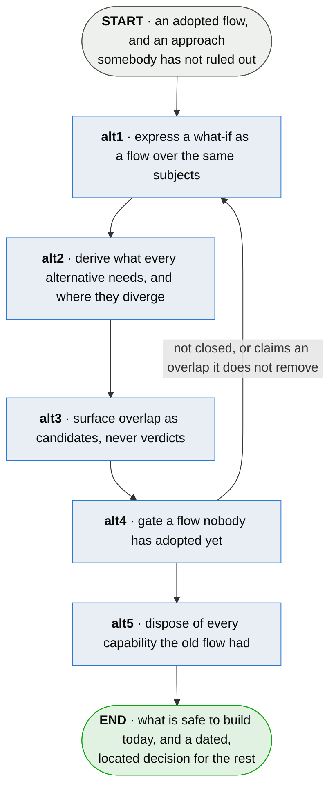

# alt · weigh an alternative

**Last updated** 2026-09-14 v1

What somebody does to explore a different approach without copying the plan, and to find out what
both approaches need before choosing between them. Reads the flows
[spe · specify a process](spe-specify-a-process.md) produced, and hands a chosen flow back to it.

## Nodes

### alt1 · express a what-if as a flow over the same subjects

> **As somebody weighing an alternative approach I want to explore it without copying the plan, so
> that the cost of considering it is not what stops me considering it.**

#### Information

| Information | IO | Description | Required | Provenance |
|---|---|---|---|---|
| alt1-inf1 | In | `flow` | yes | parent |
| alt1-inf2 | Out | `flow.variant_of` | yes | authored |

#### User Requirements
  * alt1-ur1 - an alternative is a flow over the same subjects, so exploring one duplicates nothing
  * alt1-ur2 - a flow says which flow it is an alternative to; the adopted flow is nobody's
    alternative

#### System Requirements

#### Non-Functional Requirements
  * alt1-nfr1 - copying a plan to explore an alternative is what makes alternatives unaffordable

#### Unknowns
  * alt1-u1 - how an alternative is declared, whether alternatives may nest or compose, and what
    happens to a subject existing only under one nobody chose, are undecided
  * alt1-u2 - overlap is valuable at two or three alternatives and there is a ceiling nobody has
    found, past which the shared part shrinks to the trivial and the spec reads as a decision tree

---

### alt2 · derive what every alternative needs, and where they diverge

> **As somebody who has not chosen between two approaches yet I want to know what both of them
> need, so that I can start building today and make the choice where it actually sits.**

#### Information

| Information | IO | Description | Required | Provenance |
|---|---|---|---|---|
| alt2-inf1 | In | `flow.variant_of` | yes | alt1 |
| alt2-inf2 | Out | `overlap` | yes | derived |
| alt2-inf3 | Out | `divergence_point` | yes | derived |

#### User Requirements
  * alt2-ur1 - what every declared alternative requires is derived, and is safe to build before
    the choice is made
  * alt2-ur2 - where the alternatives stop agreeing is derived and named
  * alt2-ur3 - a what-if becomes a dated, located choice with a known cost

#### System Requirements

#### Non-Functional Requirements

#### Unknowns

---

### alt3 · surface overlap as candidates, never verdicts

> **As somebody being told two parts of my plan might be the same thing I want that offered as a
> suspicion, so that a guess never arrives wearing the authority of a proof.**

#### Information

| Information | IO | Description | Required | Provenance |
|---|---|---|---|---|
| alt3-inf1 | In | `flow` | yes | parent |
| alt3-inf2 | Out | `overlap_candidate` | yes | derived |

#### User Requirements
  * alt3-ur1 - a mechanical pass surfaces candidates: two flows producing one output, two
    subjects claiming one responsibility, one term defined twice
  * alt3-ur2 - detection emits candidates and never verdicts
  * alt3-ur3 - a candidate never becomes a status, and nothing downstream may treat it as one

#### System Requirements
  * alt3-sr1 - two definitions of one name that disagree are reported as a **fact** rather than
    a candidate

#### Non-Functional Requirements
  * alt3-nfr1 - a heuristic permitted to look like a proof is this method's own failure mode

#### Unknowns
  * alt3-u1 - a detector that cries overlap too often trains its reader to dismiss it, and no bar
    is defined for how sure a candidate must be before it is worth raising — a heuristic nobody
    trusts and a heuristic nobody runs are the same heuristic

---

### alt4 · gate a flow nobody has adopted yet

> **As somebody handed a proposed redesign I want it checked before I adopt it, so that accepting a
> suggestion is not the step where its faults become mine.**

#### Information

| Information | IO | Description | Required | Provenance |
|---|---|---|---|---|
| alt4-inf1 | In | `flow` | yes | parent |
| alt4-inf2 | In | `overlap_candidate` | yes | alt3 |
| alt4-inf3 | Out | `flow_completeness` | yes | derived |

#### User Requirements
  * alt4-ur1 - the same closure and overlap checks run against a flow nobody has accepted yet
  * alt4-ur2 - a proposal that fails closure, or fails to reduce the overlap it claimed to
    remove, is rejected

#### System Requirements
  * alt4-sr1 - these checks need a source flow, so producing an ideal from a blank sheet is
    ungated

#### Non-Functional Requirements
  * alt4-nfr1 - whoever proposes does not dispose; the mechanical checks do

#### Unknowns
  * alt4-u1 - whether the closure properties known to matter are the whole set is not established;
    each was found by a flow failing in a way nobody anticipated

---

### alt5 · dispose of every capability the old flow had

> **As whoever depends on something the current process does I want the redesign to say what became
> of it, so that losing it is a decision somebody took rather than an omission nobody noticed.**

#### Information

| Information | IO | Description | Required | Provenance |
|---|---|---|---|---|
| alt5-inf1 | In | `flow_completeness` | yes | alt4 |
| alt5-inf2 | Out | `disposition` | yes | authored |

#### User Requirements
  * alt5-ur1 - every capability in the source has a stated disposition in the target: kept,
    replaced by a named element, or deliberately eliminated
  * alt5-ur2 - anything left undisposed is a defect rather than a decision — absence is never a
    default

#### System Requirements

#### Non-Functional Requirements
  * alt5-nfr1 - this checks the mapping and never the destination; nobody can test whether an
    ideal is good

#### Unknowns

## Glossary

| Term | Meaning |
|---|---|
| Alternative | Another flow over the same subjects, expressing a what-if without duplicating the plan. |
| Overlap | What every declared alternative requires — derived, and safe to build before the choice is made. |
| Divergence point | Where alternatives stop agreeing: the located, dated decision a what-if reduces to. |
| Overlap candidate | A mechanically surfaced suspicion that two flows or subjects cover the same ground. Never a verdict, never a status. |
| Complete flow | A flow that is closed: reachable from its start, terminating on every path, carrying every subject declared for it, and leaving no decision arm unhandled. |
| Disposition | What a redesign did with a capability that existed before it: kept, replaced by a named element, or deliberately eliminated. |
| Provenance | Where an input came from, or how an output was made. |
| Authored | Written by a person. An input nothing produces, or an output somebody typed. |
| Derived | Computed by this step from what it took in. |
| Parent | On a sub-flow's input: handed in by the chapter this one drills into. |

---

## Working notes — not part of the chapter

**alt3 and alt2 look alike and are not.** alt2's overlap is an exact intersection over declared
alternatives — arithmetic, and safe to act on. alt3's is a suspicion that two things nobody declared
related might be one thing. Keeping them as separate steps is what stops the second borrowing the
first's authority, which is alt3-nfr1 stated structurally rather than only in prose.
