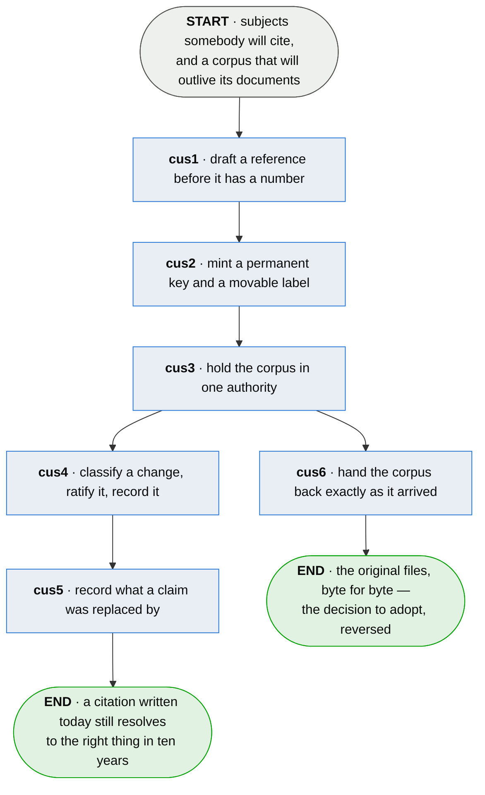

# cus · keep the corpus

**Last updated** 2026-10-26 v3

What somebody responsible for a body of specifications does to keep it citable for as long as
anything points at it: hold it in one authority, name its subjects so the name outlives the number,
and record what every change did. Entered from [spe · specify a process](spe-specify-a-process.md),
which produces what is held. Exits to [vie · answer an audience](vie-answer-an-audience.md), which
renders from it, and to [sha · share a word across owners](sha-share-a-word-across-owners.md) where
two owners' specs define one word.

## Nodes

### cus1 · draft a reference before it has a number

> **As somebody drafting I want to reference a subject I have not numbered yet, so that I never
> have to know the answer in order to have written the question.**

#### Information

| Information | IO | Description | Required | Provenance |
|---|---|---|---|---|
| cus1-inf1 | In | `chapter` — while it is a draft | yes | parent |
| cus1-inf2 | Out | `provisional_reference` | yes | authored |

#### User Requirements
  * cus1-ur1 - a provisional reference is explicitly marked and cannot be mistaken for a permanent
    one
  * cus1-ur2 - it resolves only within its own draft
  * cus1-ur3 - a draft may be complete and internally consistent while carrying nothing permanent

#### System Requirements
  * cus1-sr1 - an id minted at authoring time welds identity to position, which is what makes
    insertion expensive

#### Non-Functional Requirements

#### Unknowns
  * cus1-u1 - whether the provisional-then-assigned split is worth its ceremony below institutional
    scale is undecided: it is unarguable for a corpus amended by many hands across sessions, and
    for one author writing one chapter it may be an extra step against a cost they would never pay

---

### cus2 · mint a permanent key and a movable label

> **As anybody citing this corpus I want the thing I point at to keep one identity while the number
> I write it as is free to change, so that renumbering a document never silently repoints a
> citation.**

#### Information

| Information | IO | Description | Required | Provenance |
|---|---|---|---|---|
| cus2-inf1 | In | `provisional_reference` | yes | cus1 |
| cus2-inf2 | Out | `subject` | yes | authored |
| cus2-inf3 | Out | `subject.key` | yes | generated |
| cus2-inf4 | Out | `subject.label` | yes | authored |
| cus2-inf5 | Out | `assignment` | yes | derived |

#### User Requirements
  * cus2-ur1 - the key is opaque, assigned once, and never issued again for anything
  * cus2-ur2 - the label is the citation a human reads and writes, and a subject may carry
    several at once
  * cus2-ur3 - a label may be retired and later reissued, because nothing resolves through it
  * cus2-ur4 - a number is free when nothing cites it, not when no file carries it
  * cus2-ur5 - the resolution of a provisional reference into a key is recorded

#### System Requirements
  * cus2-sr1 - the key is time-sortable, so an ordering survives without a central counter
  * cus2-sr2 - a label nests no deeper than the bound the corpus declares
  * cus2-sr3 - renumbering is one audited pass: rename one subject and every citation to it moves
    at once

#### Non-Functional Requirements
  * cus2-nfr1 - identity and legibility are different jobs and one token does not do both

#### Unknowns
  * cus2-u1 - how deep a composition may nest before a citation stops being said correctly is not
    measured; the working value is four, and what would settle it is transcription error rate
    against depth over citations copied by hand between documents

---

### cus3 · hold the corpus in one authority

> **As somebody who has to trust a document I want it rendered from the record rather than kept
> beside it, so that what I am reading cannot have been edited by somebody who left no trace.**

#### Information

| Information | IO | Description | Required | Provenance |
|---|---|---|---|---|
| cus3-inf1 | In | `subject` | yes | cus2 |
| cus3-inf2 | In | `subject.claim` | yes | authored |
| cus3-inf3 | Out | `corpus_store` | yes | derived |
| cus3-inf4 | Out | `corpus_store.format_version` | yes | generated |
| cus3-inf5 | Out | `subject.claim_digest` | yes | derived |
| cus3-inf6 | Out | `name_conflict` | optional | derived |

#### User Requirements
  * cus3-ur1 - subjects, claims, lineage and change history live in one place, and every
    document is a view of it
  * cus3-ur2 - a rendered document is never hand-edited
  * cus3-ur3 - the subject is one boundary doing four jobs — what a citation names, what a diff
    displays, what a reviewer reads, and the most that is ever handed outside the method
  * cus3-ur4 - the file says which version wrote it, and a file carrying no stamp is read as the
    version it structurally is
  * cus3-ur5 - a word two owners' specs both define is handed to the technical staff who reconcile
    it (sha), and neither owner's spec is failed or changed for it — two business units may use one
    word for different things

#### System Requirements
  * cus3-sr1 - the store lives in the adopter's own repository as plain text, reviewable in a pull
    request
  * cus3-sr2 - the format is a published commitment from the first release
  * cus3-sr3 - a citation records the digest of the claim it was written against

#### Non-Functional Requirements
  * cus3-nfr1 - a method holding the corpus creates one home rather than a second; a tool that
    derives status from a run may never hold a copy of somebody's subjects

#### Unknowns
  * cus3-u1 - what shape the store takes on disk is undecided: one file per subject merges cleanly
    and reads well in a diff but loses global ordering, and one file per chapter reads as a
    document and conflicts on every concurrent change at the same line

---

### cus4 · classify a change, ratify it, record it

> **As a reviewer I want to be told whether a change altered what a subject claims, so that I can
> spend my attention on the changes that did.**

#### Information

| Information | IO | Description | Required | Provenance |
|---|---|---|---|---|
| cus4-inf1 | In | `subject.claim` | yes | authored |
| cus4-inf2 | In | `subject.claim_digest` | yes | cus3 |
| cus4-inf3 | Out | `change` | yes | derived |
| cus4-inf4 | Out | `change.classification` | yes | authored |
| cus4-inf5 | Out | `change.ratified_by` | yes | authored |

#### User Requirements
  * cus4-ur1 - every change is classified as what it did to the claim, and everything is
    reported other than punctuation, spelling and capitalisation
  * cus4-ur2 - a person ratifies the classification, and the ratification is what is stored
  * cus4-ur3 - a stored verdict is never recomputed

#### System Requirements
  * cus4-sr1 - the proposal a deterministic pass makes exists only between the pass and the
    ratification, and is never written down
  * cus4-sr2 - the pass runs over normalised text

#### Non-Functional Requirements
  * cus4-nfr1 - version control answers which bytes moved and can never answer whether the claim
    changed

#### Unknowns

---

### cus5 · record what a claim was replaced by

> **As somebody following a citation to a claim that has moved I want to arrive at what replaced
> it, so that a reference into an old document is worth following at all.**

#### Information

| Information | IO | Description | Required | Provenance |
|---|---|---|---|---|
| cus5-inf1 | In | `change` | yes | cus4 |
| cus5-inf2 | In | `subject.key` | yes | cus2 |
| cus5-inf3 | Out | `lineage` | yes | authored |

#### User Requirements
  * cus5-ur1 - supersession, splitting and merging are recorded between subjects
  * cus5-ur2 - a citation to something split reports *ambiguous, and here are the candidates*

#### System Requirements
  * cus5-sr1 - lineage is data rather than prose

#### Non-Functional Requirements

#### Unknowns

---

### cus6 · hand the corpus back exactly as it arrived

> **As whoever has to approve trying this I want import then export to return my files byte for
> byte, so that adopting the method is a decision I can reverse.**

#### Information

| Information | IO | Description | Required | Provenance |
|---|---|---|---|---|
| cus6-inf1 | In | `corpus_store` | yes | cus3 |
| cus6-inf2 | Out | `export` | yes | derived |

#### User Requirements
  * cus6-ur1 - import then export returns the original files byte for byte
  * cus6-ur2 - reversibility is a property of the tool, stated where somebody deciding whether
    to adopt will read it

#### System Requirements
  * cus6-sr1 - the round trip is the cheapest correctness test the method has — import, export,
    diff, expect nothing

#### Non-Functional Requirements
  * cus6-nfr1 - a method that can hold a corpus hostage will not be let near one that matters

#### Unknowns

## Glossary

| Term | Meaning |
|---|---|
| Subject | The thing a citation names — a step, a decision, an unknown. |
| Permanent key | The identity a subject keeps forever: opaque, assigned once, never reissued. Nothing a human types. |
| Label | The citation a human reads and writes. Several may point at one subject, and one may be retired and reissued, because nothing resolves through it. |
| Provisional reference | A marked reference in a draft, before identity has been assigned. Resolvable only inside its own draft. |
| Assignment | The step where a provisional reference becomes a permanent key. Its record is most of what a change report contains. |
| Corpus store | The authority: subjects, claims, lineage and change history in one place. Documents are rendered from it. |
| Claim digest | The content address of a normalised claim, recorded by a citation so a rewritten claim does not stay green. |
| Lineage | Supersession, splitting and merging, held as relations between subjects rather than as prose. |
| Round trip | Import then export, returning the original files byte for byte. |
| Provenance | Where an input came from, or how an output was made. |
| Authored | Written by a person. An input nothing produces, or an output somebody typed. |
| Derived | Computed by this step from what it took in. |
| Generated | Made by a tool rather than by a person, and not recomputable. |

---

## Working notes — not part of the chapter

**The store is specified and the shape of it is cus3-u1.** What it must hold is stated; where the
bytes sit is not, and the two candidates trade merge behaviour against global ordering.

**cus2-ur4 is the load-bearing line.** A number free because no file carries it, and a number free
because nothing cites it, are different facts, and only a register outliving its documents tells
them apart.
