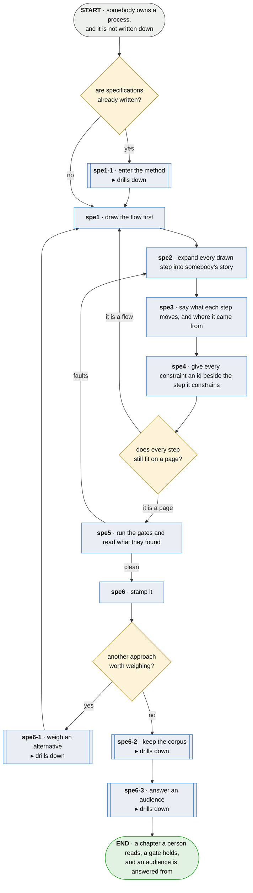

# spe · specify a process

**Last updated** 2026-10-26 v9

What somebody who owns a process does to write it down, so that what they decided can be argued
with and what they left out can be found. This is the method's main flow: every other flow is one
of its steps. A team with specifications already written enters through
[spe1-1 · enter the method](spe1-1-enter-the-method.md); another approach to a stamped flow is weighed in
[spe6-1 · weigh an alternative](spe6-1-weigh-an-alternative.md); what this produces is held by
[spe6-2 · keep the corpus](spe6-2-keep-the-corpus.md), where technical staff also reconcile a word
two owners' specs both define; and [spe6-3 · answer an audience](spe6-3-answer-an-audience.md) reads
the result. Every other chapter's file is named for the step it expands, so the names alone show
the tree.

## Nodes

### spe1-1 · enter the method

> **As somebody with specifications already written I want to start the method on them as they
> are, so that trying it costs a run rather than a rewrite.**

#### Information

| Information | IO | Description | Required | Provenance |
|---|---|---|---|---|
| spe1-1-inf1 | In | `chapter` | yes | authored |
| spe1-1-inf2 | In | `fault` | yes | observed |
| spe1-1-inf3 | Out | `conventions` | yes | derived |
| spe1-1-inf4 | Out | `sibling_spec` | optional | derived |
| spe1-1-inf5 | Out | `step` | yes | derived |
| spe1-1-inf6 | Out | `requirement` | yes | derived |

#### User Requirements

#### System Requirements

#### Non-Functional Requirements

#### Unknowns

---

### spe1 · draw the flow first

> **As somebody who owns a process I want to draw it before I describe it, so that a step I would
> have forgotten has nowhere to hide.**

#### Information

| Information | IO | Description | Required | Provenance |
|---|---|---|---|---|
| spe1-inf1 | In | `process` | yes | authored |
| spe1-inf2 | Out | `flow` | yes | authored |
| spe1-inf3 | Out | `chapter` | yes | authored |
| spe1-inf4 | Out | `chapter.title` | yes | authored |
| spe1-inf5 | Out | `step.id` | yes | authored |

#### User Requirements
  * spe1-ur1 - the flow is drawn before any step is described
  * spe1-ur2 - a back-edge is legal: rework, retry and *go back and amend*
  * spe1-ur3 - one activity drawn twice under two names is visible; in prose it is not
  * spe1-ur4 - the chapter's own title says what process it is, in the language of the work
  * spe1-ur5 - a corpus has one main flow, and every other flow is drawn from it as a sub-flow or
    referenced from a flow that is, so a reader starting at the top can reach every chapter

#### System Requirements
  * spe1-sr1 - the drawing renders wherever markdown does, with nothing built first
  * spe1-sr2 - every fact a chapter states is in the one file — no include mechanism, no
    template
  * spe1-sr3 - a label carrying a quote or a bracket is quoted
  * spe1-sr4 - a shape carries one meaning across every chapter of the corpus
  * spe1-sr5 - every other flow is a drill-down of the step it is entered from, and its file and
    ids are named for that step — `ch1-3-…` expands `ch1-3` — so the file names alone show the tree

#### Non-Functional Requirements
  * spe1-nfr1 - a flow too dense to read on one sheet has a step in it that is really a process

#### Unknowns

---

### spe2 · expand every drawn step into somebody's story

> **As a reader following the drawing I want every box to open into a story, so that what I am
> looking at says who wants it and why, rather than only what somebody called it.**

#### Information

| Information | IO | Description | Required | Provenance |
|---|---|---|---|---|
| spe2-inf1 | In | `flow` | yes | spe1 |
| spe2-inf2 | In | `step.id` | yes | spe1 |
| spe2-inf3 | Out | `step` | yes | authored |
| spe2-inf4 | Out | `step.story` | yes | authored |

#### User Requirements
  * spe2-ur1 - every step is one story: *as a role I want something so that a goal*
  * spe2-ur2 - the *so that* is the person's benefit and never the system's achievement
  * spe2-ur3 - a step drawn and never expanded, and a block no box reaches, are both named
  * spe2-ur4 - the role is somebody who needs what the step does, never "the reader of this
    chapter" standing in for them
  * spe2-ur5 - every step of one chapter describes an act at the same altitude

#### System Requirements
  * spe2-sr1 - a step's id is namespaced to its flow and issued once; rewording keeps it,
    changing what it claims does not
  * spe2-sr2 - ids sort under a plain sort: each number is left-padded to the width its largest
    member needs
  * spe2-sr3 - an id written as an example is spelled without its prefix

#### Non-Functional Requirements
  * spe2-nfr1 - the role may be a machine, and usually should not be

#### Unknowns

---

### spe3 · say what each step moves, and where it came from

> **As whoever has to perform a step I want to know what it needs before it starts and what it
> leaves behind, so that *does this step have what it needs* is a question with an answer.**

#### Information

| Information | IO | Description | Required | Provenance |
|---|---|---|---|---|
| spe3-inf1 | In | `step` | yes | spe2 |
| spe3-inf2 | Out | `information_row` | yes | authored |
| spe3-inf3 | Out | `information_row.provenance` | yes | authored |
| spe3-inf4 | Out | `information_row.required` | yes | authored |
| spe3-inf5 | Out | `glossary_entry` | yes | authored |
| spe3-inf6 | Out | `technical_definition` | optional | authored |

#### User Requirements
  * spe3-ur1 - what a step takes and leaves is stated in the step's own rows
  * spe3-ur2 - every row says where the information came from
  * spe3-ur3 - a row says whether the step requires the information or takes it when it is there
  * spe3-ur4 - an arrow names what moves along it, not only the condition or the outcome
  * spe3-ur5 - the glossary says what the words mean, and goes last in every chapter

#### System Requirements
  * spe3-sr1 - provenance is one of: a step of this flow, `parent`, `authored`, `observed`,
    `generated`, or `derived`
  * spe3-sr2 - `observed` is read off a run, or off the world as it stands
  * spe3-sr3 - `generated` is minted rather than recomputed
  * spe3-sr4 - the column answers *if this were lost, could it be got back*
  * spe3-sr5 - types, lengths, keys and nullability live in a document behind the step

#### Non-Functional Requirements
  * spe3-nfr1 - information that exists only inside a step is still stated

#### Unknowns

---

### spe4 · give every constraint an id beside the step it constrains

> **As somebody in the room I want what is required, undecided or imposed on us to carry an id
> beside the step it affects, so that we can point at the same thing instead of describing it to
> each other.**

#### Information

| Information | IO | Description | Required | Provenance |
|---|---|---|---|---|
| spe4-inf1 | In | `step` | yes | spe2 |
| spe4-inf2 | Out | `requirement` | yes | authored |
| spe4-inf3 | Out | `requirement.kind` | yes | authored |
| spe4-inf4 | Out | `open_unknown` | optional | authored |

#### User Requirements
  * spe4-ur1 - a constraint is written as a requirement with its own id, on the step it constrains
  * spe4-ur2 - requirements are separated by kind: what the person needs, what the system must
    do, what holds whatever the design
  * spe4-ur3 - something the work deliberately does not do is a requirement, never an unknown
  * spe4-ur4 - an unknown says what is undecided and what would settle it, and hangs off the step
    it affects
  * spe4-ur5 - a value known to exist and not yet measured is stated with what would confirm it

#### System Requirements
  * spe4-sr1 - there is no section for constraints anywhere; a constraint sits with its step

#### Non-Functional Requirements
  * spe4-nfr1 - if the story and the requirements are complete, there is no prose left to write
  * spe4-nfr2 - a chapter states what is, and never what happened, why it was tried, or how big
    it is
  * spe4-nfr3 - a measurement stays and its owner goes — a number needs no attribution
  * spe4-nfr4 - whether something is built is derived from a run, never stated by a chapter
  * spe4-nfr5 - which tests prove a step is carried by the annotation on the test, never by the
    chapter

#### Unknowns

---

### spe5 · run the gates and read what they found

> **As the author I want the chapter checked before anybody reads it, so that a step I drew and
> never expanded is found by something other than the person I was hoping to convince.**

#### Information

| Information | IO | Description | Required | Provenance |
|---|---|---|---|---|
| spe5-inf1 | In | `chapter` | yes | spe1 |
| spe5-inf2 | In | `information_row` | yes | spe3 |
| spe5-inf3 | In | `requirement` | yes | spe4 |
| spe5-inf4 | In | `sibling_spec` | optional | spe1-1 |
| spe5-inf5 | Out | `fault` | yes | derived |

#### User Requirements
  * spe5-ur1 - a fault names the file, the id where one applies, and what to do about it
  * spe5-ur2 - every input a step takes is an earlier step's output, handed in by a parent, or
    arrived from outside
  * spe5-ur3 - information that accumulates and no later step consumes is reported
  * spe5-ur4 - something a step takes that nothing anywhere defines is a fault, after the
    corpus's siblings have been read
  * spe5-ur5 - a flow is checked closed: reachable from its start, terminating on every path,
    every declared step placed, every decision arm handled
  * spe5-ur6 - a requirement or a row that names something the chapter already has as a step is
    reported
  * spe5-ur7 - a link to a flow file that is not in the corpus is reported, so a hand-off to a
    chapter nobody wrote is never mistaken for one that exists

#### System Requirements
  * spe5-sr1 - the gate is a pure source scan — no build, no network, no rendering
  * spe5-sr2 - a check that cannot read the file reports that it could not, never that it passed
  * spe5-sr3 - inputs a nested chapter takes from its parent are read against the parent, not
    reported as unproduced
  * spe5-sr4 - a step states its constraints under the five headings, in one order; a heading
    dropped or moved is a fault
  * spe5-sr5 - a requirement is named for the step it is stated under, and an id is stated once
  * spe5-sr6 - a required input is checked against the steps the flow actually reaches it from,
    along the paths that do not loop; a back-edge is legal, so *upstream* is only defined there
  * spe5-sr7 - a name and its dotted parts are one thing at two grains, and the relation runs one
    way per question: a step producing the whole SUPPLIES a step taking a part, and a step taking a
    part READS a step producing the whole. Neither reverses — producing a part does not supply a
    demand for the whole, and taking the whole is not a demand for any particular part
  * spe5-sr8 - where a corpus names its main flow, a flow neither drawn from it nor referenced
    from a flow that is reachable is a fault
  * spe5-sr9 - an element a sub-flow makes and a flow outside it takes is declared at the step it
    leaves through; one made and taken inside the sub-flow, at whatever depth, has not left it

#### Non-Functional Requirements
  * spe5-nfr1 - a gate reports what it can decide and never what it would have to judge
  * spe5-nfr2 - evidence is never authored — asserting a document says something proves only
    that somebody wrote it
  * spe5-nfr3 - the direction is stated once, so no two checks can answer the same question about
    one element differently

#### Unknowns
  * spe5-u1 - a stated constraint and the code that enforces it can still drift, and nothing
    compares them; the candidates are a citation from the constraint to what enforces it, a test
    asserting the two agree, or accepting this as a place the method describes and does not verify

---

### spe6 · stamp it

> **As somebody holding a printed chapter I want it to say when it last changed, so that I can tell
> whether the copy in my hand is the one being discussed.**

#### Information

| Information | IO | Description | Required | Provenance |
|---|---|---|---|---|
| spe6-inf1 | In | `chapter` | yes | spe1 |
| spe6-inf2 | Out | `chapter.stamp` | yes | authored |

#### User Requirements
  * spe6-ur1 - the stamp sits immediately under the title, before anything else a reader meets
  * spe6-ur2 - the stamp reads a date and a version
  * spe6-ur3 - every change is a version, including a typo
  * spe6-ur4 - the stamp may say whether its date was derived or authored

#### System Requirements
  * spe6-sr1 - where the corpus is version-controlled, the date and the version derive from the
    commit

#### Non-Functional Requirements
  * spe6-nfr1 - a chapter does not read its own commit date, and the method requires no version
    control system
  * spe6-nfr2 - a save time is not a substitute for a commit

#### Unknowns
  * spe6-u1 - whether the version is padded so a plain sort orders it, or a chapter is ordered by
    its date and then its version as a number

---

### spe6-1 · weigh an alternative

> **As somebody with a stamped flow I want to explore another approach without copying the plan,
> so that I choose between them knowing what each needs.**

#### Information

| Information | IO | Description | Required | Provenance |
|---|---|---|---|---|
| spe6-1-inf1 | In | `flow` | yes | spe1 |
| spe6-1-inf2 | Out | `disposition` | yes | derived |

#### User Requirements

#### System Requirements

#### Non-Functional Requirements

#### Unknowns

---

### spe6-2 · keep the corpus

> **As somebody responsible for what this produces I want it held so a citation written today
> still resolves in ten years, so that a chapter outlives its document.**

#### Information

| Information | IO | Description | Required | Provenance |
|---|---|---|---|---|
| spe6-2-inf1 | In | `chapter` | yes | spe1 |
| spe6-2-inf2 | Out | `subject.key` | yes | derived |

#### User Requirements

#### System Requirements

#### Non-Functional Requirements

#### Unknowns

---

### spe6-3 · answer an audience

> **As whoever an audience asks I want to answer from the spec and its run, so that nobody keeps a
> document beside the spec for each audience.**

#### Information

| Information | IO | Description | Required | Provenance |
|---|---|---|---|---|
| spe6-3-inf1 | In | `subject.key` | yes | spe6-2 |
| spe6-3-inf2 | Out | `view` | yes | derived |

#### User Requirements

#### System Requirements

#### Non-Functional Requirements

#### Unknowns

## Glossary

| Term | Meaning |
|---|---|
| Flow | One process, drawn. The authority a chapter's steps expand out of. |
| Step | One box of a flow and one user story — the same object, which is what stops a chapter keeping two lists that have to agree. |
| Information row | What a step takes or leaves, stated in the step's own table with where it came from. |
| Provenance | Where an input came from, or how an output was made. |
| Authored | Written by a person. An input nothing produces, or an output somebody typed. |
| Derived | Computed by this step from what it took in. |
| Observed | Read off a run, or off the world as it stands. |
| Generated | Made by a tool rather than by a person, and not recomputable. |
| Main flow | The one flow a corpus starts from. Every other chapter expands one of its steps, at whatever depth, and is named for the step it expands. |
| Parent | On a sub-flow's input: handed in by the chapter that drills into this one. |
| Requirement | A constraint with an id, on the step it constrains — what the person needs, what the system must do, or what holds whatever the design. |
| Open unknown | Something nobody has decided, with what would settle it, hanging off the step it affects. |
| Technical definition | A document behind a step carrying types, keys and formats, so a chapter stays in the language of the work. |
| Fault | What a gate found. Names the file, the id, and what to do about it. |

---

## Working notes — not part of the chapter

**The gates that survive are the ones with an invariant.** spe5's requirements are the review set:
chain, unconsumed, provenance, closure, restatement. What cannot be checked — altitude, whether a
claim is any good — is stated as a requirement a reader holds (spe2-ur5) rather than pretended into
a check.
