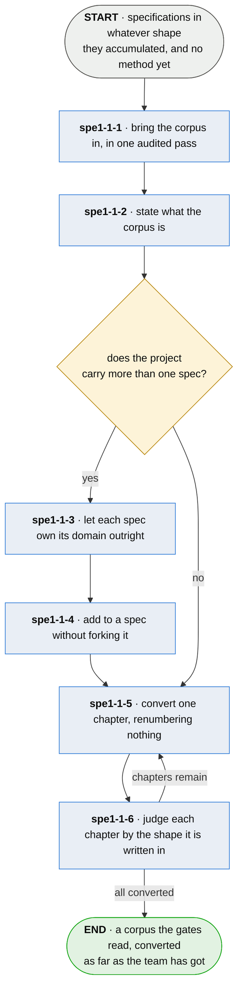

# spe1-1 · enter the method

**Last updated** 2026-10-26 v6

What a team with years of specifications in whatever shape they accumulated does to start using
this method on them — without hand-converting everything first, and without a day where nothing
resolves. Exits to [spe · specify a process](spe-specify-a-process.md), which is what they do
afterwards.

## Nodes

### spe1-1-1 · bring the corpus in, in one audited pass

> **As somebody with years of decisions in whatever shape they accumulated I want to enter the
> method without hand-converting them first, so that the cost of trying it is a run rather than a
> project.**

#### Information

| Information | IO | Description | Required | Provenance |
|---|---|---|---|---|
| spe1-1-1-inf1 | In | `existing_corpus` | yes | authored |
| spe1-1-1-inf2 | Out | `migration` | yes | derived |
| spe1-1-1-inf3 | Out | `subject.label` | yes | derived |

#### User Requirements
  * spe1-1-1-ur1 - the pass records what it changed, in the same shape as any other change report
  * spe1-1-1-ur2 - the ids a corpus arrived with are kept, so entering costs nobody a re-minted
    corpus
  * spe1-1-1-ur3 - the pass is reversible, as spe6-2-6 holds

#### System Requirements
  * spe1-1-1-sr1 - the pass is bounded and reported: what it read, what it changed, and what it
    could not

#### Non-Functional Requirements
  * spe1-1-1-nfr1 - the normal adopter is not a fresh repository

#### Unknowns

---

### spe1-1-2 · state what the corpus is

> **As somebody whose spec cites a neighbouring one I want my spec to say where the rest of the
> corpus is, so that a correct reference to a neighbour is never reported as a reference to
> nothing.**

#### Information

| Information | IO | Description | Required | Provenance |
|---|---|---|---|---|
| spe1-1-2-inf1 | In | `migration` | yes | spe1-1-1 |
| spe1-1-2-inf2 | Out | `conventions` | yes | authored |
| spe1-1-2-inf3 | Out | `sibling_spec` | yes | authored |

#### User Requirements
  * spe1-1-2-ur1 - a spec names its sibling specs, which are read for the names they define and
    never checked here
  * spe1-1-2-ur2 - a project says what its own subjects are called
  * spe1-1-2-ur3 - the conventions live in one place, read by the command and by whatever the
    project runs as a test
  * spe1-1-2-ur4 - a sibling spec is read under its own conventions, never this one's: each
    project keeps its own conventions file, and a sibling that names its files differently is
    still read

#### System Requirements
  * spe1-1-2-sr1 - what the corpus is cannot be inferred; a gate reading one spec directory is told
    rather than guesses
  * spe1-1-2-sr2 - a project carrying two specs in two namespaces puts a conventions file beside
    each

#### Non-Functional Requirements
  * spe1-1-2-nfr1 - *defined nowhere* means nowhere after the siblings have been read

#### Unknowns

---

### spe1-1-3 · let each spec own its domain outright

> **As somebody reading one of a project's several specs I want to know that nothing in it is
> restated from another, so that I never have to work out which of two statements is current.**

#### Information

| Information | IO | Description | Required | Provenance |
|---|---|---|---|---|
| spe1-1-3-inf1 | In | `conventions` | yes | spe1-1-2 |
| spe1-1-3-inf2 | Out | `spec` | yes | authored |

#### User Requirements
  * spe1-1-3-ur1 - no spec restates what another owns, and every cross-reference is a citation
  * spe1-1-3-ur2 - where the work spans repositories, the spec splits per repository and the
    contract is stated from both sides

#### System Requirements
  * spe1-1-3-sr1 - a name defined in two specs is reconciled as spe6-2-3-1-3 requires

#### Non-Functional Requirements
  * spe1-1-3-nfr1 - several specs are one truth by that rule, never by anybody remembering which
    document is current

#### Unknowns

---

### spe1-1-4 · add to a spec without forking it

> **As whoever maintains an extension I want its steps specified without forking the spec it
> extends, so that the two cannot drift into disagreeing about anything.**

#### Information

| Information | IO | Description | Required | Provenance |
|---|---|---|---|---|
| spe1-1-4-inf1 | In | `spec` | yes | spe1-1-3 |
| spe1-1-4-inf2 | Out | `spec.extends` | yes | authored |

#### User Requirements
  * spe1-1-4-ur1 - an extension declares the spec it builds on, and may contribute steps, unknowns
    and flows of its own
  * spe1-1-4-ur2 - an extension may not redefine, restate or contradict anything the base owns
  * spe1-1-4-ur3 - a base stands on its own and works when no extension is present

#### System Requirements
  * spe1-1-4-sr1 - citation runs one way: an extension cites its base, and a base never cites an
    extension
  * spe1-1-4-sr2 - a base cannot enumerate what extends it

#### Non-Functional Requirements
  * spe1-1-4-nfr1 - stating the base once, completely, is what makes the two incapable of disagreeing

#### Unknowns
  * spe1-1-4-u1 - a base cannot rewrite citations held in an extension it does not know about, so a
    renumber clean in the base silently breaks anything extending it; the candidate answer is that
    publishing freezes ids, which makes renumbering a breaking change rather than a tidy-up

---

### spe1-1-5 · convert one chapter, renumbering nothing

> **As somebody holding a spec in an older shape I want to convert one chapter at a time without
> renumbering anything, so that every citation into it keeps resolving while I work.**

#### Information

| Information | IO | Description | Required | Provenance |
|---|---|---|---|---|
| spe1-1-5-inf1 | In | `chapter` | yes | parent |
| spe1-1-5-inf2 | Out | `step` | yes | authored |
| spe1-1-5-inf3 | Out | `requirement` | yes | authored |
| spe1-1-5-inf4 | Out | `open_unknown` | optional | authored |

#### User Requirements
  * spe1-1-5-ur1 - a chapter converts without renumbering
  * spe1-1-5-ur2 - each claim of the older shape is read for what **kinds** of thing are in it, and
    each kind gets its own id
  * spe1-1-5-ur3 - what comes out was already written down, in the one place the older shape had for
    everything
  * spe1-1-5-ur4 - a chapter is brought to the current shape when it is touched

#### System Requirements
  * spe1-1-5-sr1 - a chapter is moved into the current shape first, and its claims are read for
    their kinds after

#### Non-Functional Requirements
  * spe1-1-5-nfr1 - a corpus may be half converted for as long as its owner likes

#### Unknowns

---

### spe1-1-6 · judge each chapter by the shape it is written in

> **As the owner of a corpus written before this format I want a chapter judged by the shape it is
> written in, so that converting is something I can start on a Tuesday with one chapter.**

#### Information

| Information | IO | Description | Required | Provenance |
|---|---|---|---|---|
| spe1-1-6-inf1 | In | `fault` | yes | parent |
| spe1-1-6-inf2 | In | `conventions` | yes | spe1-1-2 |
| spe1-1-6-inf3 | Out | `chapter.shape` | yes | derived |

#### User Requirements
  * spe1-1-6-ur1 - a chapter is held to the shape it is written in; one in an older shape is read
    the old way and counted
  * spe1-1-6-ur2 - converting one chapter puts that chapter in scope and no other
  * spe1-1-6-ur3 - nothing has to be declared, unset or remembered for a half-converted corpus to be
    judged correctly
  * spe1-1-6-ur4 - every check the gate carries runs on every spec; there is no flag holding one
    back

#### System Requirements
  * spe1-1-6-sr1 - what a reader must judge is reported and never gated; what has an invariant is
    gated and never merely reported

#### Non-Functional Requirements
  * spe1-1-6-nfr1 - every corpus that exists predates a new format

#### Unknowns

## Glossary

| Term | Meaning |
|---|---|
| Conventions | What a project's subjects are called and where its spec lives. One home, read by the command and by whatever the project runs as a test. |
| Sibling spec | Another spec directory of the same corpus. Read for what it defines, never checked here. |
| Corpus | Every spec directory whose flows exchange information — one body, whatever number of repositories it spans. |
| Spec | One body of specification with a domain of its own. A project may carry several; none restates another. |
| Extension | A spec that declares a base and adds to it. Additive only, never restating, and meaningless without the base it names. |
| Base | The spec an extension builds on. Stands alone, and never cites what extends it. |
| Migration | One audited, reported, reversible pass over a corpus that predates the method. |

---

## Working notes — not part of the chapter

**spe1-1-5 and spe1-1-6 are the phase-in.** A chapter is judged by the shape it is written in, so converting one puts that chapter in scope and no other, and neither half of a half-converted
corpus is failed for being the half it is.

**The ordering question the flow answers.** spe1-1-2 comes before any conversion because *defined
nowhere* cannot be switched on until the corpus extent is stated (spe1-1-2-nfr1) — a conversion run
under an unstated extent reports faults that are references to neighbours.
