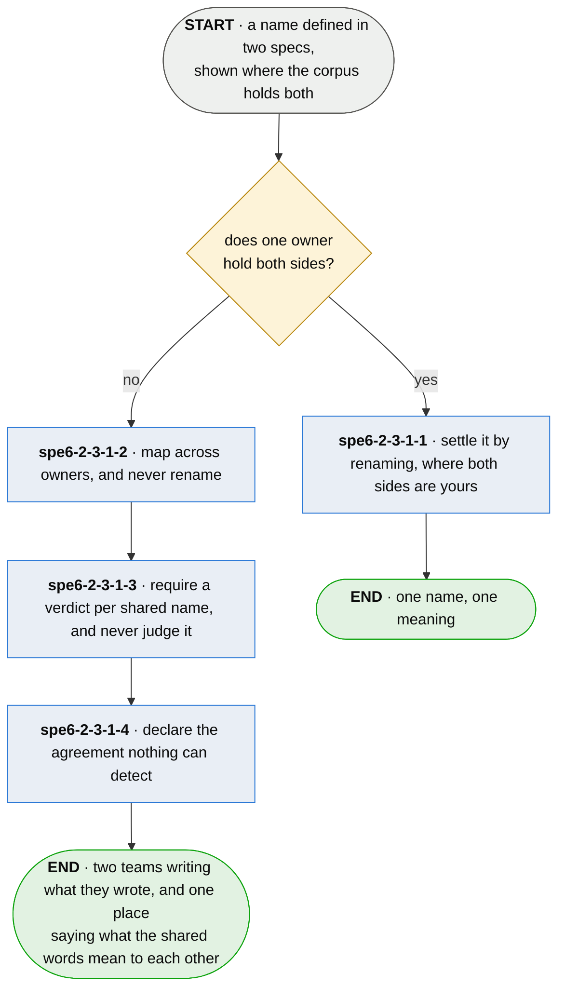

# spe6-2-3-1 · share a word across owners

**Last updated** 2026-10-26 v3

What technical staff do when two teams' specs define the same word: settle it where one of them
owns both sides, and where neither does, say what the two words mean to each other without either
team being made to rewrite theirs. Two business units may use one word for different things. Entered from [spe6-2 · keep the corpus](spe6-2-keep-the-corpus.md), where the
corpus holding both specs shows the shared word.

## Nodes

### spe6-2-3-1-1 · settle it by renaming, where both sides are yours

> **As somebody who owns both specs carrying one word I want to rename one of them, so that the
> corpus has one name for one thing and nobody downstream has to hold a mapping.**

#### Information

| Information | IO | Description | Required | Provenance |
|---|---|---|---|---|
| spe6-2-3-1-1-inf1 | In | `name_conflict` | yes | parent |
| spe6-2-3-1-1-inf2 | Out | `subject.label` | yes | authored |

#### User Requirements
  * spe6-2-3-1-1-ur1 - where one owner holds both sides, a collision is settled by renaming rather than
    mapped
  * spe6-2-3-1-1-ur2 - the rename is one audited pass, so every citation moves with the name

#### System Requirements

#### Non-Functional Requirements
  * spe6-2-3-1-1-nfr1 - this is available only because one person may decide for both sides

#### Unknowns

---

### spe6-2-3-1-2 · map across owners, and never rename

> **As one of two teams sharing a word I want the other side's spec left alone, so that adopting a
> shared vocabulary is not somebody taking a decision that was mine.**

#### Information

| Information | IO | Description | Required | Provenance |
|---|---|---|---|---|
| spe6-2-3-1-2-inf1 | In | `name_conflict` | yes | parent |
| spe6-2-3-1-2-inf2 | Out | `namespace_mapping` | yes | authored |

#### User Requirements
  * spe6-2-3-1-2-ur1 - across an ownership boundary nothing is renamed: both sides go on writing what they
    wrote
  * spe6-2-3-1-2-ur2 - what is legitimate is *these two words mean one thing* or *these two identical
    words mean two things*

#### System Requirements
  * spe6-2-3-1-2-sr1 - the shape is the same whether the boundary is two business units, two
    repositories or two teams

#### Non-Functional Requirements
  * spe6-2-3-1-2-nfr1 - a word carries meaning held by the people who use it; renaming it is taking a
    decision that is not yours

#### Unknowns
  * spe6-2-3-1-2-u1 - who authors a mapping neither namespace owns is undecided, and the candidates carry
    different failure modes — whoever integrates the two will decide for the convenience of the
    integration, a joint act by both owners is correct and is the one nobody has time for, and
    somebody above both is the shape that scales and the shape that most often decides in ignorance
    of what a word costs the people using it

---

### spe6-2-3-1-3 · require a verdict per shared name, and never judge it

> **As a developer reading another team's spec I want to be told whether their word and ours are
> one thing, so that I stop answering it by reading both and hoping.**

#### Information

| Information | IO | Description | Required | Provenance |
|---|---|---|---|---|
| spe6-2-3-1-3-inf1 | In | `namespace_mapping` | yes | spe6-2-3-1-2 |
| spe6-2-3-1-3-inf2 | Out | `namespace_mapping.verdict` | yes | authored |

#### User Requirements
  * spe6-2-3-1-3-ur1 - a name defined in two namespaces demands an entry, and its absence is a fault
  * spe6-2-3-1-3-ur2 - the verdict says whether the two are one subject, two subjects, or an agreed word
    over different meanings
  * spe6-2-3-1-3-ur3 - nothing mechanical judges the verdict

#### System Requirements

#### Non-Functional Requirements
  * spe6-2-3-1-3-nfr1 - the value is the disagreement it surfaces: one thing under two words, or one
    word over two things
  * spe6-2-3-1-3-nfr2 - a gate cannot judge whether an answer is right and can insist the question was
    asked

#### Unknowns

---

### spe6-2-3-1-4 · declare the agreement nothing can detect

> **As whoever integrates two teams I want the case where both specs agree and the meanings differ
> written down by somebody, so that the one disagreement no check can raise is still on record when
> the two teams' code meets.**

#### Information

| Information | IO | Description | Required | Provenance |
|---|---|---|---|---|
| spe6-2-3-1-4-inf1 | In | `synonym_candidate` | yes | parent |
| spe6-2-3-1-4-inf2 | Out | `namespace_mapping` — for the undetectable case | yes | authored |

#### User Requirements
  * spe6-2-3-1-4-ur1 - two namespaces may agree in every respect a check can compare and still mean
    different things
  * spe6-2-3-1-4-ur2 - it is sharpest in a set of legal values: two teams admit the same word and
    disagree about what it means

#### System Requirements
  * spe6-2-3-1-4-sr1 - nothing here attempts to detect it

#### Non-Functional Requirements
  * spe6-2-3-1-4-nfr1 - every collision check fires on disagreement, so the case where both sides agree
    passes silently
  * spe6-2-3-1-4-nfr2 - the method knows the two words exist and knows it cannot tell them apart

#### Unknowns

## Glossary

| Term | Meaning |
|---|---|
| Name conflict | One name, two definitions that disagree. A fact rather than a candidate, which is what separates it from a duplicate candidate. |
| Synonym candidate | Two names that agree in every respect a check can compare. A candidate, and it stays a judgement. |
| Mapping | An entry between two namespaces for a name they both define. Owned by neither, carrying a verdict a gate requires and never judges. |
| Verdict | What a mapping says the two names mean to each other: one subject, two subjects, or an agreed word over different meanings. |

---

## Working notes — not part of the chapter

**spe6-2-3-1-4 is the chapter's reason for existing.** spe6-2-3-1-2 and spe6-2-3-1-3 are procedure; spe6-2-3-1-4 is the case the
procedure exists to catch, and it is the one no gate will ever raise. A reader who takes only the
first two has a mapping discipline that reports every cheap collision and stays silent on the
expensive one.
