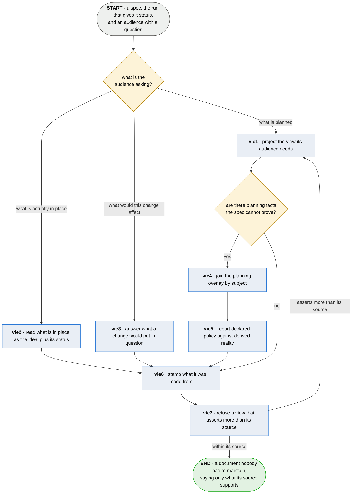

# vie · answer an audience

**Last updated** 2026-10-26 v2

What somebody does to answer one of the several audiences a plan has — an executive reading budget
and schedule, whoever asks what is actually in place, whoever asks what a change would cost —
without maintaining a document beside the spec for each of them. Reads what
[cus · keep the corpus](cus-keep-the-corpus.md) holds, and the run that gives it status.

## Nodes

### vie1 · project the view its audience needs

> **As one of a plan's audiences I want my document computed from the spec, so that nobody has to
> remember to update it and nobody has to wonder whether they did.**

#### Information

| Information | IO | Description | Required | Provenance |
|---|---|---|---|---|
| vie1-inf1 | In | `spec` | yes | authored |
| vie1-inf2 | In | `run` | yes | observed |
| vie1-inf3 | Out | `view` | yes | derived |

#### User Requirements
  * vie1-ur1 - every audience-facing rendering is computed from the spec on demand, never authored
    and never maintained
  * vie1-ur2 - each audience gets the document it needs rather than one document everybody reads
    past
  * vie1-ur3 - a view is produced for a request and kept by nobody

#### System Requirements

#### Non-Functional Requirements
  * vie1-nfr1 - an authored view is a second source of truth and drifts by default

#### Unknowns
  * vie1-u1 - how a generated view is known to be faithful is undecided: the spec is the one thing
    in the method with no upstream source to check against, so a wrong view is undetectable in a
    way a wrong status never is; the candidates are generating wholly and verifying somehow,
    generating only the mechanical parts and authoring the drawing, or authoring and parity-checking

---

### vie2 · read what is in place as the ideal plus its status

> **As whoever asks what is actually built I want the answer read off the ideal and its run, so
> that there is no second document for the first one to disagree with.**

#### Information

| Information | IO | Description | Required | Provenance |
|---|---|---|---|---|
| vie2-inf1 | In | `spec` | yes | authored |
| vie2-inf2 | In | `run` | yes | observed |
| vie2-inf3 | Out | `view` | yes | derived |

#### User Requirements
  * vie2-ur1 - what is really in place is the ideal plus its derived status; the unproven
    subjects **are** what is not there
  * vie2-ur2 - no separate as-built document is authored

#### System Requirements

#### Non-Functional Requirements
  * vie2-nfr1 - two documents that disagree leave the reader believing whichever they opened

#### Unknowns

---

### vie3 · answer what a change would put in question

> **As somebody about to edit a claim I want to be told which proofs that puts in doubt, so that
> the question I actually ask before editing has an answer worth waiting for.**

#### Information

| Information | IO | Description | Required | Provenance |
|---|---|---|---|---|
| vie3-inf1 | In | `manifest` | yes | observed |
| vie3-inf2 | In | `citation.ref` | yes | observed |
| vie3-inf3 | In | `subject.key` | yes | parent |
| vie3-inf4 | Out | `view` | yes | derived |

#### User Requirements
  * vie3-ur1 - the proofs a change puts in doubt are a lookup rather than an investigation
  * vie3-ur2 - the answer is *which proofs are now in question* and never *what else might
    break*

#### System Requirements
  * vie3-sr1 - only direct citations are reported — the tests that name the subject — never
    transitive code impact

#### Non-Functional Requirements
  * vie3-nfr1 - a map from subject to code that rots is worse than no map

#### Unknowns

---

### vie4 · join the planning overlay by subject

> **As an executive I want budget, schedule and resource beside the subjects they belong to, so
> that the facts I plan with are not smuggled into a spec that cannot prove them.**

#### Information

| Information | IO | Description | Required | Provenance |
|---|---|---|---|---|
| vie4-inf1 | In | `view` | yes | vie1 |
| vie4-inf2 | In | `overlay` | yes | authored |
| vie4-inf3 | In | `overlay.entry` | yes | authored |
| vie4-inf4 | Out | `view` — joined | yes | derived |

#### User Requirements
  * vie4-ur1 - the overlay is keyed by subject and joined at view time, never merged into the spec
  * vie4-ur2 - an overlay may **add** facts and may never restate one the spec holds
  * vie4-ur3 - an overlay carries the facts nothing can prove: budget, schedule, resource,
    priority, estimate

#### System Requirements

#### Non-Functional Requirements
  * vie4-nfr1 - a defined place for these facts is what stops them being smuggled into the spec

#### Unknowns
  * vie4-u1 - what keeps the overlay honest is undecided: none of it is provable, the discipline
    protecting the spec does not reach it, and these are the fields an executive view leans on
    hardest; whether it is versioned, reviewed, expiring, or marked unverifiable wherever it
    surfaces is open

---

### vie5 · report declared policy against derived reality

> **As a team with a standard I want the view to tell me where we are not meeting it, so that our
> policy is somewhere it can be checked rather than somewhere it cannot.**

#### Information

| Information | IO | Description | Required | Provenance |
|---|---|---|---|---|
| vie5-inf1 | In | `overlay.entry.required_depth` | yes | authored |
| vie5-inf2 | In | `verdict.achieved` | yes | observed |
| vie5-inf3 | Out | `view` — with the gap named | yes | derived |

#### User Requirements
  * vie5-ur1 - what a team expects is authored, what it achieved is derived, and the comparison
    is reported as a fact
  * vie5-ur2 - nothing here enforces the policy; failing a build on the gap is the team's own
    gate to add

#### System Requirements
  * vie5-sr1 - the comparison is mechanical: what was achieved either meets what was declared or
    does not

#### Non-Functional Requirements
  * vie5-nfr1 - a tool that refuses to carry a team's policy makes them keep it somewhere it
    cannot be checked

#### Unknowns

---

### vie6 · stamp what it was made from

> **As somebody being shown a roll-up I want it to say what it was made from and when, so that I
> can tell a report from a slide.**

#### Information

| Information | IO | Description | Required | Provenance |
|---|---|---|---|---|
| vie6-inf1 | In | `view` | yes | vie1 |
| vie6-inf2 | Out | `view.provenance` | yes | derived |

#### User Requirements
  * vie6-ur1 - every rendering states which spec, which run, which overlay, and when it was made

#### System Requirements

#### Non-Functional Requirements
  * vie6-nfr1 - a roll-up without provenance is indistinguishable from a slide, and a stale one
    is worse than none

#### Unknowns

---

### vie7 · refuse a view that asserts more than its source

> **As anybody downstream of a number I want it to be the number the run produced, so that the
> whole apparatus underneath it is worth having.**

#### Information

| Information | IO | Description | Required | Provenance |
|---|---|---|---|---|
| vie7-inf1 | In | `view` | yes | vie1 |
| vie7-inf2 | In | `view.provenance` | yes | vie6 |
| vie7-inf3 | Out | `view.assertion` | yes | derived |

#### User Requirements
  * vie7-ur1 - a projection may summarise, aggregate and omit
  * vie7-ur2 - a projection may never state a status, a completion or a date its source does not
    support
  * vie7-ur3 - a refused view goes back to be projected again rather than onward

#### System Requirements

#### Non-Functional Requirements
  * vie7-nfr1 - aggregation is where fakery re-enters a verified system
  * vie7-nfr2 - the method is worthless if the number shown upward is not the number the run
    produced

#### Unknowns

## Glossary

| Term | Meaning |
|---|---|
| View | A projection of the spec for an audience — a roll-up, a flow, a trace table. Derived on demand, never authored or maintained. |
| Overlay | Planning facts the spec does not own because nothing can prove them, keyed by subject and joined at view time. Additive only. |
| Required depth | What a team expects a subject to reach. Authored in the overlay, compared against what was achieved, never imposed. |
| View provenance | Which spec, which run, which overlay, and when — stamped on every rendering. |
| Assertion | What a view says. May summarise and omit; may never exceed its source. |

---

## Working notes — not part of the chapter

**Three questions, one apparatus.** vie1, vie2 and vie3 are the three things an audience actually
asks, and they are separate steps rather than one because their inputs differ: the first needs the
run for status, the second *is* the run read against the ideal, and the third needs what cites what.
All three converge on the same stamp and the same refusal, which is what stops one of them
acquiring a private set of rules.

**`manifest`, `citation.ref` and `verdict.achieved` are the neighbour's.** They are consumed here
and defined in the sibling corpus, which is what ent2 exists to let a gate resolve.
